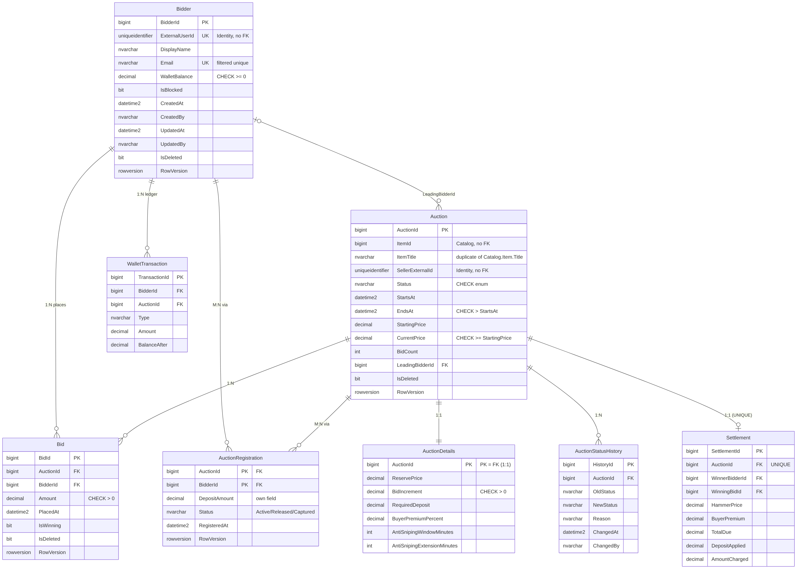
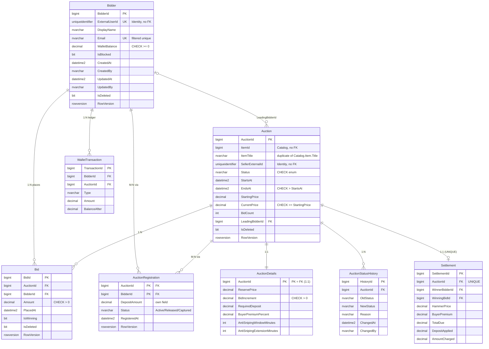
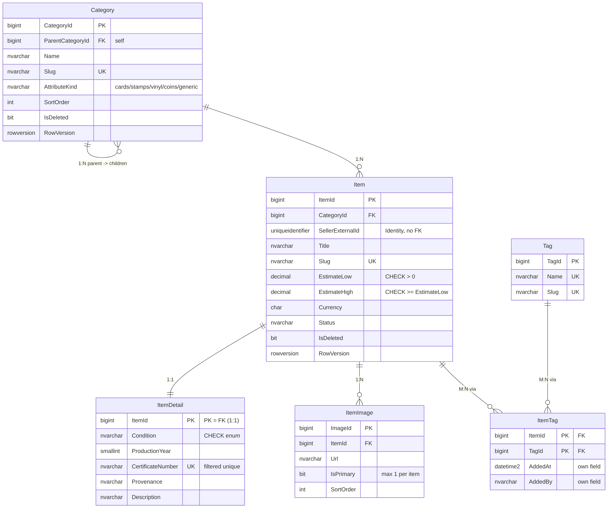
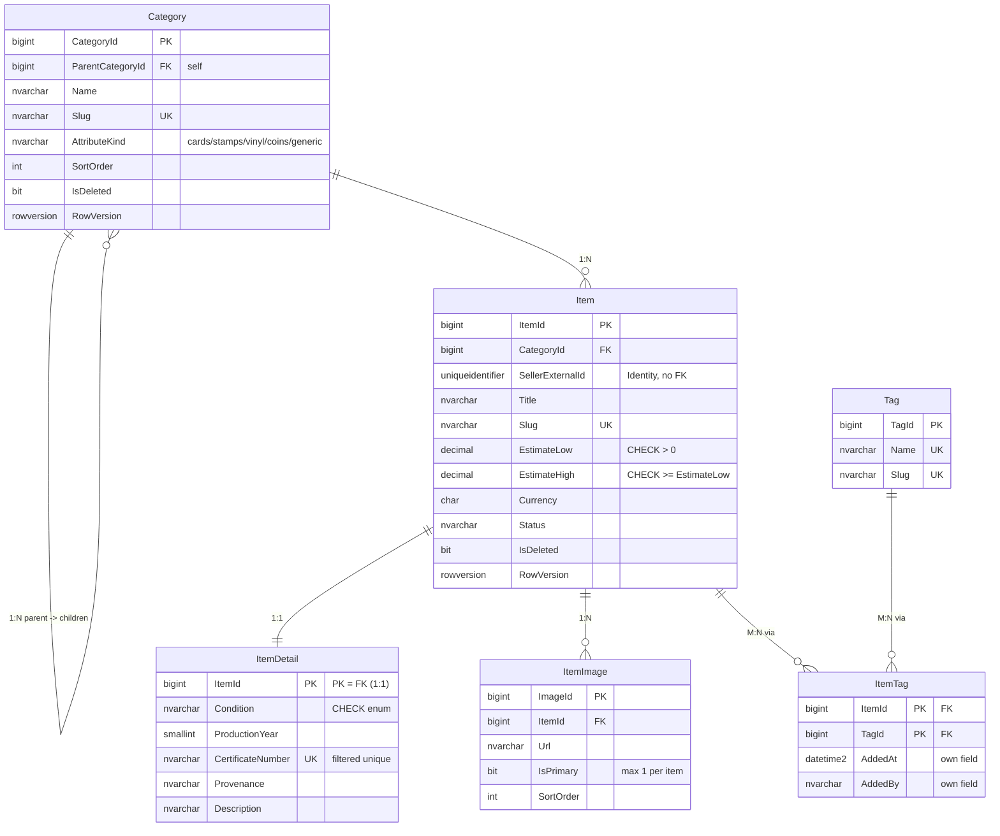
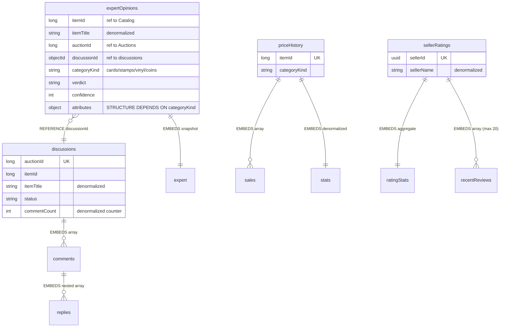

# AuctionHouse — аукціонний дім колекційних предметів

**Практичне заняття № 01.** Проєктування та розробка баз даних для мікросервісної архітектури. **Практичне заняття № 02** (тришарова архітектура Auctions, ADO.NET + Dapper, .NET Aspire) — у [§11](#11-лабораторна-2--тришарова-архітектура-на-adonet-та-dapper). **Практичне заняття № 03** (Catalog на EF Core: Code First, міграції, пагінація, валідація, Serilog, специфікації) — у [§12](#12-лабораторна-3--тришарова-архітектура-на-entity-framework-core). **Практичне заняття № 04** (Community на MongoDB: Clean Architecture, CQRS + MediatR, pipeline behaviors) — у [§13](#13-лабораторна-4--clean-architecture--cqrs--mongodb).
Три незалежні бази даних для подальшої розробки трьох мікросервісів (ASP.NET Core).

| Проєкт | Контекст | СУБД і технологія доступу | Каталог у репозиторії |
|---|---|---|---|
| №1 | **Auctions** — аукціони, ставки, застави, розрахунки | SQL Server + ADO.NET & Dapper | `db/p1/` |
| №2 | **Catalog** — каталог колекційних предметів | SQL Server + EF Core (Code First, Fluent API) | `db/p2/` |
| №3 | **Community** — експертні висновки, обговорення, ціни, рейтинги | MongoDB | `db/p3/` |

```
AuctionHouse/
├── README.md
├── docs/
│   ├── contexts.md           домен, контексти, політика дублювання, посилання без FK
│   ├── erd-p1-auctions.md    ERD проєкту №1
│   ├── erd-p2-catalog.md     ERD проєкту №2
│   └── p3-mongodb.md         колекції, приклади документів, запити
├── db/
│   ├── p1/          (Auctions)  schema.sql · procedures.sql · seed.sql · verify.sql
│   ├── p2/          (Catalog)   schema.sql · seed.sql
│   └── p3/          (Community) collections.js · seed.js · queries.js
├── scripts/
│   ├── docker-compose.db.yml    SQL Server + MongoDB для розробки
│   ├── deploy.ps1               розгортання всіх трьох баз (Windows)
│   └── deploy.sh                те саме для Linux/macOS
├── Platform.slnx                одне рішення на всю платформу
├── Platform.AppHost/            .NET Aspire AppHost: SQL Server + MongoDB + Auctions.Api + Catalog.Api + Community.WebApi
└── Services/
    ├── Auctions/                Проєкт №1 — ADO.NET + Dapper (Лаба 2)
    ├── Catalog/                 Проєкт №2 — EF Core (Лаба 3)
    │   ├── Catalog.Api/         контролери, Program.cs, appsettings*.json, Dockerfile
    │   ├── Catalog.Bll/         сервіси, DTO, Mapping/, Validation/, Specifications/, Caching/
    │   ├── Catalog.Dal/         CatalogDbContext, Configurations/, Migrations/, Repositories/, UnitOfWork/, Seeding/
    │   ├── Catalog.Domain/      сутності, доменні винятки
    │   └── Catalog.Tests/       модульні тести (xUnit)
    └── Community/               Проєкт №3 — Clean Architecture + CQRS + MongoDB (Лаба 4)
        ├── Community.Domain/         сутності, value objects, інтерфейси репозиторіїв
        ├── Community.Application/    Commands/, Queries/, Behaviors/, Caching/
        ├── Community.Infrastructure/ Mongo-контекст, BSON-мапінг, репозиторії, індекси, сідінг
        └── Community.WebApi/         контролери, Program.cs, обробка помилок
```

## Зміст

1. [Предметна область і три контексти](#1-предметна-область-і-три-контексти)
2. [Політика дублювання даних і узгодженості](#2-політика-дублювання-даних-і-узгодженості)
3. [Три самостійні бази без FOREIGN KEY між ними](#3-три-самостійні-бази-без-foreign-key-між-ними)
4. [Проєкт №1 — SQL Server (ADO.NET / Dapper)](#4-проєкт-1--sql-server-adonet--dapper)
5. [Проєкт №2 — SQL Server (EF Core)](#5-проєкт-2--sql-server-ef-core)
6. [Проєкт №3 — MongoDB](#6-проєкт-3--mongodb)
7. [Початкові дані (ідемпотентні seed-скрипти)](#7-початкові-дані-ідемпотентні-seed-скрипти)
8. [Розгортання: порядок запуску](#8-розгортання-порядок-запуску)
9. [Перевірка індексів, обмежень і процедур](#9-перевірка-індексів-обмежень-і-процедур)
10. [Відповідність критеріям прийому (Лаба 1)](#10-відповідність-критеріям-прийому)
11. [Лабораторна 2 — тришарова архітектура на ADO.NET та Dapper](#11-лабораторна-2--тришарова-архітектура-на-adonet-та-dapper)
12. [Лабораторна 3 — тришарова архітектура на Entity Framework Core](#12-лабораторна-3--тришарова-архітектура-на-entity-framework-core)
13. [Лабораторна 4 — Clean Architecture + CQRS + MongoDB](#13-лабораторна-4--clean-architecture--cqrs--mongodb)

---

## 1. Предметна область і три контексти

**Домен.** Онлайн-аукціонний дім для колекціонерів (колекційні картки, поштові марки, вінілові платівки, монети).
*Продавець* виставляє предмет; *учасники торгів* реєструються на аукціон, вносять заставу з внутрішнього гаманця
і роблять ставки; після закриття торгів переможець оплачує лот, а *експерти й спільнота* оцінюють автентичність
предмета, обговорюють лот і формують історію цін та репутацію продавця.

Предметну область розділено на **три незалежні контексти (Bounded Contexts)**. Кожен має власну БД, власну модель і логіку;
жодних спільних схем і міжсервісних JOIN-ів. **Кожна сутність належить рівно одному контексту.**

| Контекст | БД | Агрегати (root + частини) | Сутності / колекції | Життєвий цикл |
|---|---|---|---|---|
| **Catalog** | `AuctionHouse_Catalog` (SQL Server) | `Item` (+ `ItemDetail`, `ItemImage`, `ItemTag`); `Category`; `Tag` | `Category`, `Item`, `ItemDetail`, `ItemImage`, `Tag`, `ItemTag` | Draft → Listed → InAuction → Sold / Withdrawn |
| **Auctions** | `AuctionHouse_Auctions` (SQL Server) | `Auction` (+ `AuctionDetails`, `Bid`, `AuctionRegistration`, `Settlement`, `AuctionStatusHistory`); `Bidder` (+ `WalletTransaction`) | `Bidder`, `Auction`, `AuctionDetails`, `Bid`, `AuctionRegistration`, `WalletTransaction`, `Settlement`, `AuctionStatusHistory` | Draft → Scheduled → Active → Closed → Settled (або Unsold / Cancelled) |
| **Community** | `AuctionHouse_Community` (MongoDB) | `expertOpinions`; `discussions` (+ вбудовані коментарі); `priceHistory` (+ вбудовані продажі); `sellerRatings` (+ вбудовані відгуки) | `expertOpinions`, `discussions`, `priceHistory`, `sellerRatings` | створюється під час торгів, доповнюється після розрахунку |

Користувачі (продавці, учасники, експерти) живуть у зовнішній системі ідентифікації (Identity / Keycloak, лабораторна № 9).
Усі контексти посилаються на користувача його **GUID** (`ExternalUserId`), а не FK.

---

## 2. Політика дублювання даних і узгодженості

Дублювання допустиме й очікуване: воно розв'язує сервіси та пришвидшує читання. Для кожного дубльованого поля визначено
**власника** (єдине джерело істини) і **механізм підтримки узгодженості**. Модель узгодженості — *eventual consistency*:
контекст-власник публікує подію (RabbitMQ, лабораторна № 8), споживачі оновлюють свої копії; споживачі ідемпотентні
(обробка повторної події не змінює результат).

| № | Дубльоване поле (де зберігається) | Власник (джерело істини) | Навіщо дублюємо | Механізм підтримки узгодженості | Знімок чи події |
|---|---|---|---|---|---|
| 1 | `Auctions.Auction.ItemTitle` | `Catalog.Item.Title` | Список і вітрина аукціонів без звернення до Catalog | Знімок під час `sp_CreateAuction` + оновлення за подією `ItemUpdated` (`UPDATE … WHERE ItemId = @ItemId`) | **Знімок + події** |
| 2 | `expertOpinions.itemTitle`, `discussions.itemTitle`, `priceHistory.itemTitle` (Community) | `Catalog.Item.Title` | Показ висновку/обговорення без звернення до Catalog | Знімок під час створення документа + `updateMany({itemId})` за подією `ItemUpdated` | **Знімок + події** |
| 3 | `expertOpinions.categoryKind`, `priceHistory.categoryKind` (Community) | `Catalog.Category.AttributeKind` | Вибір структури поля `attributes` і групування аналітики без запиту до Catalog | Знімок під час створення (категорія предмета змінюється рідко); за зміни — подія `ItemUpdated` | **Знімок** |
| 4 | `Catalog.Item.Status` (стани `InAuction`, `Sold`) | `Auctions.Auction.Status` | Каталог показує, чи предмет у торгах/проданий, без запиту до Auctions | Проєкція за подіями `AuctionActivated`, `AuctionClosed`, `AuctionSettled`, `AuctionCancelled` | **Події** |
| 5 | `priceHistory.sales[].finalPrice` і `priceHistory.stats` (Community) | `Auctions.Settlement.HammerPrice` | Аналітика цін без звернення до Auctions | Подія `AuctionSettled`: `$push` у `sales` (унікальність за `auctionId` робить обробку ідемпотентною) і перерахунок `stats` | **Події** |
| 6 | `Auctions.Bidder.DisplayName`; `expertOpinions.expert.displayName`; `discussions.comments[].author.displayName`; `sellerRatings.sellerName`, `recentReviews[].buyerName` | Identity (зовнішня система) | Показ імені без запиту до Identity | Знімок під час першої появи користувача + оновлення за подією `UserProfileUpdated` | **Знімок + події** |

Допомагають узгодженості й **локальні гарантії**: у кожній БД діють власні `UNIQUE`/`CHECK`, а всі зміни агрегату виконуються в одній
транзакції (SQL) або в межах одного документа (MongoDB).

---

## 3. Три самостійні бази без FOREIGN KEY між ними

Посилання на сутність іншого контексту — це **звичайний стовпець/поле з її Id, без зовнішнього ключа**
(СУБД різні, бази автономні, цілісність забезпечується подіями, а не FK).

| Звідки (контекст.об'єкт.поле) | Куди посилається | Тип поля | Примітка |
|---|---|---|---|
| Auctions.`Auction.ItemId` | Catalog.`Item.ItemId` | `BIGINT` | без FK; дублює `ItemTitle` |
| Auctions.`Auction.SellerExternalId` | Identity: користувач-продавець | `UNIQUEIDENTIFIER` | без FK |
| Auctions.`Bidder.ExternalUserId` | Identity: користувач | `UNIQUEIDENTIFIER`, `UNIQUE` | без FK |
| Catalog.`Item.SellerExternalId` | Identity: користувач-продавець | `UNIQUEIDENTIFIER` | без FK |
| Community.`expertOpinions.itemId` | Catalog.`Item.ItemId` | `long` | без посилальної цілісності |
| Community.`expertOpinions.auctionId`, `discussions.auctionId` | Auctions.`Auction.AuctionId` | `long` | без посилальної цілісності |
| Community.`discussions.itemId`, `priceHistory.itemId` | Catalog.`Item.ItemId` | `long` | без посилальної цілісності |
| Community.`…expert.userId`, `…author.userId`, `sellerRatings.sellerId`, `…buyerId` | Identity: користувач | `UUID` (BinData 4) | без посилальної цілісності |

Усі `FOREIGN KEY` в `schema.sql` посилаються **лише на таблиці своєї ж бази** (див. запити перевірки в розділі 9).

---

## 4. Проєкт №1 — SQL Server (ADO.NET / Dapper)

База `AuctionHouse_Auctions`. Файли: `schema.sql` (DDL, ключі, обмеження, індекси), `procedures.sql` (6 процедур, права),
`seed.sql` (дані), `verify.sql` (сценарії перевірки).

### 4.1 ERD



*Якщо діаграма не відображається, зображення вище — той самий ERD; текстове джерело (Mermaid) нижче.*



**Зв'язки (вимога «щонайменше 4 таблиці зі зв'язками 1:1, 1:N і M:N»).** Усього 8 таблиць.

| Тип | Де реалізовано | Як |
|---|---|---|
| **1:1** | `Auction` ↔ `AuctionDetails` | PK залежної таблиці `AuctionDetails.AuctionId` є одночасно FK на `Auction` |
| **1:1** | `Auction` ↔ `Settlement` | `UNIQUE (AuctionId)` у `Settlement` |
| **1:N** | `Auction` → `Bid`; `Bidder` → `Bid`; `Bidder` → `WalletTransaction`; `Auction` → `AuctionStatusHistory` | FK на боці «багатьох» |
| **M:N** | `Bidder` ↔ `Auction` через `AuctionRegistration` | проміжна таблиця з двома FK, складений PK `(AuctionId, BidderId)`, власні поля `DepositAmount`, `Status` |

### 4.2 Ключі, обмеження й індекси

**Первинні ключі: `BIGINT IDENTITY`.** Обґрунтування: послідовне значення дає компактний кластеризований індекс без фрагментації
сторінок (вставки йдуть у кінець), а 8 байт у кожному FK та некластеризованому індексі дешевші за 16 байт GUID. Розподілена генерація
ключів у межах однієї БД не потрібна. GUID використано лише для `ExternalUserId`, який належить зовнішній системі ідентифікації.

**Обмеження.**

| Тип | Приклади (таблиця.обмеження) |
|---|---|
| `PRIMARY KEY` | `PK_Bidder`, `PK_Auction`, `PK_AuctionDetails` (= FK), `PK_AuctionRegistration (AuctionId, BidderId)`, … |
| `FOREIGN KEY` | `FK_Bid_Auction`, `FK_Bid_Bidder`, `FK_AuctionDetails_Auction`, `FK_Settlement_Bid`, … |
| `UNIQUE` | `UQ_Bidder_ExternalUserId`, `UQ_Settlement_AuctionId`, `UX_Bidder_Email` (фільтрований), `UX_Bid_AuctionId_Amount` (фільтрований) |
| `CHECK` | `CK_Bidder_WalletBalance (>= 0)`, `CK_Auction_Dates (EndsAt > StartsAt)`, `CK_Auction_Prices (CurrentPrice >= StartingPrice)`, `CK_Auction_Status` (enum), `CK_Bid_Amount (> 0)`, `CK_AuctionDetails_Increment (> 0)`, `CK_AuctionDetails_Premium (0..100)`, `CK_Settlement_Amounts (TotalDue = HammerPrice + BuyerPremium)`, `CK_WalletTransaction_Type`/`Amount <> 0`/`BalanceAfter >= 0` |
| `DEFAULT` | `Status = 'Draft'`, `BidCount = 0`, `WalletBalance = 0`, `CreatedAt = SYSUTCDATETIME()`, `CreatedBy = SUSER_SNAME()`, `IsDeleted = 0`, `BidIncrement = 1`, `AntiSnipingWindowMinutes = 2`, … |

**Каскади (усвідомлено).**

| FK | Правило | Чому |
|---|---|---|
| `AuctionDetails → Auction` | `ON DELETE CASCADE` | деталі — частина агрегату й не існують без аукціону |
| усі інші FK (`Bid`, `AuctionRegistration`, `WalletTransaction`, `Settlement`, `AuctionStatusHistory`, `Auction → Bidder`) | `ON DELETE NO ACTION` | ставки, гроші та історія — аудитні дані; фізичне видалення заборонене, використовується soft delete |

**Індекси — кожен створено під конкретний запит** (жодного «сліпого» індексування):

| Індекс | Запит, який він обслуговує |
|---|---|
| `IX_Auction_Status_EndsAt` (покриваючий + фільтрований `IsDeleted = 0`, `INCLUDE ItemId, ItemTitle, CurrentPrice, BidCount`) | вітрина «активні лоти, що закінчуються найближчим часом» і фонове завдання «знайти прострочені аукціони для закриття» |
| `IX_Auction_ItemId` | «усі аукціони предмета» / перевірка дубля в `sp_CreateAuction` |
| `IX_Auction_SellerExternalId (SellerExternalId, Status)` | «мої аукціони» в кабінеті продавця |
| `UX_Bid_AuctionId_Amount (AuctionId, Amount DESC) INCLUDE (BidderId, PlacedAt, IsWinning)` | «поточна найвища ставка / топ-N ставок»; `UNIQUE` не дозволяє двох однакових сум в одному аукціоні |
| `IX_Bid_BidderId_PlacedAt (BidderId, PlacedAt DESC)` | «мої ставки», найновіші першими |
| `UX_Bidder_Email` (фільтрований) | пошук учасника за email; повторне використання email після soft delete |
| `IX_AuctionRegistration_BidderId` | «аукціони, на які зареєстрований учасник» (PK покриває лише напрямок за `AuctionId`) |
| `IX_WalletTransaction_BidderId_CreatedAt` | виписка по гаманцю |
| `IX_Settlement_WinnerBidderId` | «мої покупки» |
| `IX_AuctionStatusHistory_AuctionId_ChangedAt` | хронологія статусів аукціону |

### 4.3 Аудит, soft delete та оптимістична конкурентність

* **Аудитні колонки** `CreatedAt`, `CreatedBy`, `UpdatedAt`, `UpdatedBy` є в `Bidder`, `Auction`, `AuctionDetails`, `Bid`, `AuctionRegistration`
  (в append-only таблицях `WalletTransaction`, `Settlement`, `AuctionStatusHistory` — `CreatedAt`/`CreatedBy` або `ChangedAt`/`ChangedBy`).
  `CreatedBy` за замовчуванням `SUSER_SNAME()`; процедури записують у нього параметр `@Actor`.
* **Soft delete:** `IsDeleted BIT NOT NULL DEFAULT 0` у `Bidder`, `Auction`, `Bid`; усі індекси та представлення фільтрують `IsDeleted = 0`.
* **Оптимістична конкурентність:** `RowVersion ROWVERSION` у `Bidder`, `Auction`, `Bid`, `AuctionRegistration`, `Settlement`.
  `sp_UpdateAuction` оновлює рядок лише якщо `RowVersion = @ExpectedRowVersion`, інакше `THROW 50030`.

### 4.4 Збережувані процедури (6)

| № | Процедура | Призначення |
|---|---|---|
| 1 | `sp_CreateAuction` | **C** — створення `Auction` + `AuctionDetails` + запис в історію статусів (одна транзакція); перевірка «предмет не бере участі в іншому незавершеному аукціоні» |
| 2 | `sp_UpdateAuction` | **U** — зміна параметрів чернетки/запланованого аукціону з перевіркою `RowVersion` (оптимістична конкурентність) |
| 3 | `sp_RegisterBidder` | реєстрація учасника: списання застави з гаманця, запис у `AuctionRegistration` і `WalletTransaction` |
| 4 | `sp_PlaceBid` | ставка: блокування рядка аукціону, перевірка статусу/часу/реєстрації/кроку, **anti-sniping** (ставка в останні 2 хв продовжує торги) |
| 5 | **`sp_ChangeAuctionStatus`** | **транзакційна зміна статусу** за матрицею переходів (див. нижче) |
| 6 | `sp_SettleAuction` | розрахунок з переможцем: ціна + премія покупця, залік застави, списання з гаманця, запис `Settlement` |

**R і D.** Читання — представлення `vw_ActiveAuction` та запити Dapper; видалення — soft delete (`IsDeleted`) і статус `Cancelled`.

**Процедура зміни статусу працює в явній транзакції** (`BEGIN TRANSACTION` … `COMMIT`, `SET XACT_ABORT ON`, `TRY/CATCH` із `ROLLBACK`
і повторним `THROW`) **та відхиляє недопустимий перехід керованою помилкою `50001`** з повідомленням `Invalid status transition: <old> -> <new>`.

Матриця дозволених переходів:

| З \ До | Scheduled | Active | Closed | Cancelled | Settled |
|---|:-:|:-:|:-:|:-:|:-:|
| **Draft** | ✓ | — | — | ✓ | — |
| **Scheduled** | — | ✓ | — | ✓ | — |
| **Active** | — | — | ✓ | ✓ | — |
| **Closed** | — | — | — | ✓ | лише `sp_SettleAuction` |
| Settled / Unsold / Cancelled | кінцеві стани, переходів немає |

Побічні ефекти в тій самій транзакції: при `Closed` визначається переможець і перевіряється резервна ціна
(немає ставок або резерв не досягнуто → результат `Unsold`); застави програвших повертаються на гаманці
(`WalletTransaction` типу `DepositRelease`); при `Cancelled` повертаються всі застави; кожна зміна пишеться в `AuctionStatusHistory`.

**Конкурентність і рівень ізоляції.** Рівень — `READ COMMITTED` (за замовчуванням) + точкові підказки `UPDLOCK, HOLDLOCK` на рядку `Auction`
в `sp_PlaceBid`: ставки одного аукціону виконуються послідовно (друга чекає й перевіряє мінімальну суму вже за актуальною `CurrentPrice`,
тому «втрачених оновлень» немає), а різні аукціони не блокують один одного. `SERIALIZABLE` на всю процедуру дав би ту саму коректність,
але більше блокувань і ризик deadlock. **Порядок блокувань в усіх процедурах однаковий: Auction → Bidder**, що виключає взаємоблокування.
Додатковий рівень захисту — `UNIQUE (AuctionId, Amount)` на ставках.

**Права найменших привілеїв.** Роль `auctions_app` отримує лише `EXECUTE` на процедури та `SELECT` на представлення;
прямі `INSERT/UPDATE/DELETE` у таблиці заборонені (`DENY`).

---

## 5. Проєкт №2 — SQL Server (EF Core)

База `AuctionHouse_Catalog`. Файли: `schema.sql`, `seed.sql`. `schema.sql` — це еталонна SQL-схема моделі, яку в лабораторній № 3
відтворять сутності EF Core (Fluent API) і міграції; скрипт придатний для запуску без .NET.

### 5.1 ERD



*Якщо діаграма не відображається, зображення вище — той самий ERD; текстове джерело (Mermaid) нижче.*



**6 сутностей, усі типи зв'язків:**

| Тип | Де | Примітка |
|---|---|---|
| **1:1** | `Item` ↔ `ItemDetail` | PK залежної таблиці = FK; `ON DELETE CASCADE` |
| **1:N** | `Category` → `Item`; `Item` → `ItemImage`; `Category` → `Category` (ієрархія) | FK на боці «багатьох» |
| **M:N з власним полем** | `Item` ↔ `Tag` через `ItemTag` | проміжна сутність має власні поля **`AddedAt`** (дата додавання) і **`AddedBy`** |

### 5.2 Унікальні поля, індекси, CHECK, довідникові дані

| Вимога | Реалізація |
|---|---|
| Унікальні поля | `UQ_Category_Slug`, `UQ_Item_Slug`, `UQ_Tag_Name`, `UQ_Tag_Slug`, `UX_ItemDetail_CertificateNumber` (фільтрований: допускає `NULL`), `UX_ItemImage_OnePrimaryPerItem` (не більше одного головного зображення на предмет) |
| Індекси для пошуку | `IX_Item_CategoryId_Status` (сторінка категорії, покриваючий + фільтрований), `IX_Item_Title` (пошук `LIKE 'Char%'`), `IX_Item_SellerExternalId` («мої лоти»), `IX_Category_ParentCategoryId` (дерево категорій), `IX_ItemTag_TagId` («предмети з тегом»), `IX_ItemImage_ItemId_SortOrder` |
| CHECK | `CK_Item_Estimate (EstimateLow > 0 AND EstimateHigh >= EstimateLow)` — позитивні ціни; `CK_Item_Status`; `CK_ItemDetail_Condition`; `CK_ItemDetail_Year (1000..2100)`; `CK_Category_NotOwnParent`; `CK_ItemImage_Url` |
| Довідникові дані | `Category` (5), `Tag` (5) — `seed.sql`, ключі задані явно (як `HasData` в EF Core) |
| Міграції | у лабораторній № 3 міграції EF Core відтворюють цю схему; зміни структури надалі — через міграції (`dotnet ef migrations add …`) |

Ключі — `BIGINT IDENTITY` (обґрунтування те саме, що в розділі 4.2; плюс компактні посилання `ItemId` у Auctions і Community).
Аудит (`CreatedAt/By`, `UpdatedAt/By`, `IsDeleted`) і `RowVersion` (токен оптимістичної конкурентності EF: `IsRowVersion()`) — у `Category` та `Item`.

---

## 6. Проєкт №3 — MongoDB

База `AuctionHouse_Community`, 4 колекції. `collections.js` створює колекції з **JSON Schema Validation** та індекси
(повторний запуск оновлює валідатор через `collMod`, тому це одночасно й «міграція схеми»), `seed.js` додає дані,
`queries.js` містить приклади запитів та aggregate pipeline.

### 6.1 Структура колекцій


*Якщо діаграма не відображається, зображення вище — той самий ERD; текстове джерело (Mermaid) нижче.*



| Колекція | Що моделює | Підхід |
|---|---|---|
| `expertOpinions` | висновок експерта про автентичність предмета | **гібрид**: посилання `itemId`/`auctionId`/`discussionId` + вбудований знімок експерта (`expert`) і денормалізована назва `itemTitle`; **гнучка схема** (див. нижче) |
| `discussions` | одне обговорення на аукціон | **embedding**: масив `comments[]`, у ньому вкладений масив `replies[]` (масив у масиві), лічильник `commentCount` |
| `priceHistory` | історія продажів предмета | **embedding** масиву `sales[]` + денормалізований об'єкт `stats` (`saleCount`, `avgPrice`, `minPrice`, `maxPrice`, `lastPrice`) для швидкого читання |
| `sellerRatings` | репутація продавця | **гібрид**: агрегований `stats` + вбудовані останні відгуки `recentReviews[]` (до 20); повна історія — окрема колекція в наступних лабораторних |

**Embedding чи referencing — обґрунтування.** Вбудовуємо те, що читається разом із коренем і не має сенсу окремо
(коментарі в обговоренні, продажі в історії цін). Посилаємось на слабкозв'язане або велике (висновок ↔ обговорення,
усе, що належить іншим контекстам).

**Гнучкість схеми: різні набори полів в одній колекції.** У `expertOpinions` об'єкт `attributes` залежить від `categoryKind`:

| `categoryKind` | Обов'язкові поля `attributes` | Приклад додаткових полів |
|---|---|---|
| `cards` | `gradingCompany`, `grade` | `certificateNumber`, `printRun`, `holoPattern` |
| `stamps` | `perforation`, `watermark` | `plateNumber`, `margins` (вкладений об'єкт), `cancellation` |
| `vinyl` | `matrixNumber`, `pressing` | `label`, `extras[]` (масив), `vinylCondition` |
| `coins` | `metal`, `weightGrams` | `mintMark`, `diameterMm` |

Відповідність `categoryKind` ↔ набір полів перевіряє `oneOf` у валідаторі: документ «cards» зі стемповими атрибутами СУБД відхиляє.

**Приклад документа** (`expertOpinions`, фрагмент):

```json
{
  "itemId": 1,
  "itemTitle": "Charizard Holo 1st Edition, Base Set 1999 (PSA 9)",
  "auctionId": 1,
  "discussionId": "ObjectId(65a000000000000000000101)",
  "categoryKind": "cards",
  "expert": { "userId": "UUID(5555…)", "displayName": "Dr. Andriy Savchuk", "credentials": ["Certified appraiser"] },
  "verdict": "authentic",
  "confidence": 96,
  "attributes": { "gradingCompany": "PSA", "grade": 9, "certificateNumber": "PSA-60000001" }
}
```

**Індекси** (під конкретні запити):

| Колекція | Індекс | Запит |
|---|---|---|
| `expertOpinions` | `{itemId:1, createdAt:-1}` | висновки по предмету, найновіші першими |
| `expertOpinions` | `{itemId:1, 'expert.userId':1}` **unique** | один експерт — один висновок на предмет |
| `expertOpinions` | `{categoryKind:1, verdict:1}` | модерація «сумнівні» за категорією |
| `expertOpinions` | `{discussionId:1}` sparse | висновки, пов'язані з обговоренням |
| `discussions` | `{auctionId:1}` **unique** | одне обговорення на аукціон |
| `discussions` | `{itemId:1}`; `{'comments.author.userId':1}` (multikey) | обговорення предмета; коментарі користувача |
| `priceHistory` | `{itemId:1}` **unique**; `{categoryKind:1,'stats.avgPrice':-1}` | історія предмета; аналітика категорій |
| `sellerRatings` | `{sellerId:1}` **unique**; `{'stats.average':-1,'stats.count':-1}` | рейтинг продавця; топ продавців |

**Запити й агрегації** (`queries.js`): пошук за полями, що є лише в частини документів; `$unwind` + `$group` по вкладеному масиву;
`$lookup` між колекціями за посиланням; групування за категорією; перевірка, що невалідний документ відхиляється валідатором.

---

## 7. Початкові дані (ідемпотентні seed-скрипти)

Перед кожною вставкою перевіряється наявність запису — **повторний запуск не створює дублікатів**.

| Скрипт | Механізм ідемпотентності |
|---|---|
| `db/p1/seed.sql` | `IF NOT EXISTS (…)` за природним ключем (`ExternalUserId`, `ItemId`, наявність проводок гаманця) |
| `db/p2/seed.sql` | `INSERT … SELECT … WHERE NOT EXISTS (…)` за ключем рядка; явні ключі через `IDENTITY_INSERT` |
| `db/p3/seed.js` | `updateOne({_id}, {$setOnInsert: …}, {upsert: true})` з фіксованими `_id` |

Дані узгоджені між базами: ті самі GUID користувачів і ті самі `ItemId` 1–3 / `AuctionId` 1–3
(`seed.sql` і `seed.js` припускають свіжорозгорнуті бази, у яких ідентифікатори починаються з 1).

Сценарій: **Auction 1** (Charizard) — `Active`, 4 ставки, 3 учасники із заставами; **Auction 2** (Penny Black) — `Scheduled`;
**Auction 3** (Dark Side of the Moon) — `Draft`.

---

## 8. Розгортання: порядок запуску

Потрібно: **Docker Desktop** (SQL Server 2022 і MongoDB 7 у контейнерах). На Apple Silicon образ SQL Server працює
в емуляції x86_64 (увімкніть у Docker Desktop).

**Крок 1 — підняти СУБД.**

```powershell
docker compose -f scripts/docker-compose.db.yml up -d
```

Пароль SA для розробки: `AuctionHouse_Dev#2026` (змінюється змінною середовища `MSSQL_SA_PASSWORD`; лише для локальної розробки).

**Крок 2 — розгорнути всі три бази одним скриптом.**

```powershell
./scripts/deploy.ps1          # Windows
```
```bash
./scripts/deploy.sh           # Linux / macOS
```

Скрипт виконує в такому порядку (кожен файл ідемпотентний, тож запуск можна повторювати):

| № | Файл | Що робить |
|---|---|---|
| 1 | `db/p2/schema.sql` | створює БД `AuctionHouse_Catalog`, таблиці, індекси, обмеження |
| 2 | `db/p2/seed.sql` | довідники та предмети |
| 3 | `db/p1/schema.sql` | створює БД `AuctionHouse_Auctions`, таблиці, індекси, представлення |
| 4 | `db/p1/procedures.sql` | 6 процедур, роль `auctions_app` і права |
| 5 | `db/p1/seed.sql` | учасники, аукціони, ставки, гаманці |
| 6 | `db/p3/collections.js` | колекції MongoDB, валідатори, індекси |
| 7 | `db/p3/seed.js` | документи MongoDB |

**Крок 3 (необов'язково) — сценарії перевірки.**

```powershell
./scripts/deploy.ps1 -Verify    # додатково: db/p1/verify.sql і db/p3/queries.js
```

**Ручний запуск без скрипта** (якщо встановлені `sqlcmd` і `mongosh`):

```bash
sqlcmd -S localhost -U sa -P "AuctionHouse_Dev#2026" -C -I -b -f 65001 -i db/p2/schema.sql
sqlcmd -S localhost -U sa -P "AuctionHouse_Dev#2026" -C -I -b -f 65001 -i db/p2/seed.sql
sqlcmd -S localhost -U sa -P "AuctionHouse_Dev#2026" -C -I -b -f 65001 -i db/p1/schema.sql
sqlcmd -S localhost -U sa -P "AuctionHouse_Dev#2026" -C -I -b -f 65001 -i db/p1/procedures.sql
sqlcmd -S localhost -U sa -P "AuctionHouse_Dev#2026" -C -I -b -f 65001 -i db/p1/seed.sql
mongosh "mongodb://localhost:27017" --file db/p3/collections.js
mongosh "mongodb://localhost:27017" --file db/p3/seed.js
```

(`-I` вмикає `QUOTED_IDENTIFIER`, потрібний для фільтрованих індексів; `-b` зупиняє виконання на помилці.)

---

## 9. Перевірка індексів, обмежень і процедур

**Усі FK — лише в межах своєї бази** (виконати в `AuctionHouse_Auctions` і в `AuctionHouse_Catalog`):

```sql
SELECT fk.name AS ForeignKey, OBJECT_NAME(fk.parent_object_id) AS FromTable,
       OBJECT_NAME(fk.referenced_object_id) AS ToTable, fk.delete_referential_action_desc AS OnDelete
FROM sys.foreign_keys AS fk ORDER BY FromTable;
```

**Обмеження та індекси:**

```sql
SELECT OBJECT_NAME(parent_object_id) AS TableName, name, definition FROM sys.check_constraints ORDER BY TableName;
SELECT OBJECT_NAME(object_id) AS TableName, name, is_unique, has_filter, filter_definition
FROM sys.indexes WHERE object_id IN (SELECT object_id FROM sys.tables) AND name IS NOT NULL ORDER BY TableName;
```

**Процедури:** `db/p1/verify.sql` проходить повний життєвий цикл (Create → Scheduled → Active → ставки → Closed → Settled),
показує керовані помилки (`50045`, `50046`, `50001`, `50030`), порушення `CHECK` і звіряє баланс гаманців із журналом проводок.
Ручна перевірка недопустимого переходу:

```sql
USE AuctionHouse_Auctions;
EXEC dbo.sp_ChangeAuctionStatus @AuctionId = 3, @NewStatus = N'Active', @Actor = N'tester';   -- Draft -> Active
-- Msg 50001: Invalid status transition: Draft -> Active
```

**Ідемпотентність seed:** запустіть `deploy` двічі — кількість рядків не змінюється:

```sql
SELECT (SELECT COUNT(*) FROM AuctionHouse_Auctions.dbo.Bid) AS Bids,
       (SELECT COUNT(*) FROM AuctionHouse_Catalog.dbo.Item) AS Items;   -- 4 і 3 після будь-якої кількості запусків
```

**MongoDB:** `mongosh "mongodb://localhost:27017/AuctionHouse_Community" --file db/p3/queries.js`.

---

## 10. Відповідність критеріям прийому

| Критерій | Де виконано |
|---|---|
| Описано предметну область і три незалежні контексти з їхніми сутностями | [§1](#1-предметна-область-і-три-контексти) |
| Таблиця політики дублювання даних між базами (власник, механізм: знімок/події) | [§2](#2-політика-дублювання-даних-і-узгодженості) |
| Три самостійні бази без FOREIGN KEY між ними | [§3](#3-три-самостійні-бази-без-foreign-key-між-ними), коментарі в `schema.sql` |
| Проєкт №1: ≥ 4 таблиці зі зв'язками 1:1, 1:N, M:N | [§4.1](#41-erd), `db/p1/schema.sql` |
| Ключі, обмеження й індекси під конкретні запити; каскади усвідомлені | [§4.2](#42-ключі-обмеження-й-індекси), коментарі над індексами в `schema.sql` |
| Аудитні колонки, soft delete, оптимістична конкурентність | [§4.3](#43-аудит-soft-delete-та-оптимістична-конкурентність) |
| 4–6 збережуваних процедур, транзакційна зміна статусу з керованою помилкою | [§4.4](#44-збережувані-процедури-6), `db/p1/procedures.sql` → `sp_ChangeAuctionStatus` |
| Проєкт №2: 4–6 сутностей, усі типи зв'язків, M:N з власним полем, унікальні поля, індекси, CHECK, довідники | [§5](#5-проєкт-2--sql-server-ef-core), `db/p2/` (`ItemTag.AddedAt/AddedBy`) |
| MongoDB: 3–4 колекції з embedding, referencing і гібридним підходом | [§6](#6-проєкт-3--mongodb), `db/p3/collections.js` |
| Ідемпотентні seed-скрипти для всіх баз | [§7](#7-початкові-дані-ідемпотентні-seed-скрипти) |
| Скрипти розгортання та README з порядком запуску й ERD | `scripts/`, [§8](#8-розгортання-порядок-запуску), ERD у §4.1, §5.1, §6.1 |

---

## 11. Лабораторна 2 — тришарова архітектура на ADO.NET та Dapper

Лаба продовжує Лабу 1: **Проєкт №1 (Auctions)** реалізовано як самостійну вертикаль **API → BLL → DAL** над базою `AuctionHouse_Auctions` (`db/p1`).

### 11.1 Структура рішення

```
Platform.slnx
Platform.AppHost/                 AppHost.cs: SQL Server (контейнер) + база auctionsdb + Auctions.Api
Services/Auctions/
├── Auctions.Api/                 Controllers/, ExceptionHandling/ (ProblemDetails), Program.cs, appsettings.json
├── Auctions.Bll/                 Services/, DTO/, Mapping/ (AutoMapper), Validation/, Caching/ (зарезервовано)
├── Auctions.Dal/                 Interfaces/, Repositories/ (ADO.NET + Dapper), UnitOfWork/
└── Auctions.Domain/              Models/, Exceptions/
```

Залежності: `Api → Bll → Dal → Domain` (Domain не залежить ні від чого). SQL існує **лише** в `Auctions.Dal`.

| Шар | Що містить |
|---|---|
| **Domain** | моделі `Auction`, `AuctionDetails`, `Bid`, `Bidder`, `AuctionRegistration`; винятки `NotFoundException`, `BusinessConflictException`, `ValidationException`, `DataAccessException` |
| **DAL** | `IGenericRepository<T>`; `BidRepository` — **чистий ADO.NET**; `BaseDapperRepository<T>` + `AuctionRepository` і `BidderRepository` — **Dapper**; `UnitOfWork` |
| **BLL** | DTO, AutoMapper-профілі, сервіси `AuctionService`/`BidderService`/`BidService`, валідатор бізнес-правил |
| **API** | тонкі контролери, глобальний обробник помилок (ProblemDetails), Swagger/OpenAPI |

### 11.2 DAL: репозиторії та Unit of Work

- **`IGenericRepository<T>`** — `GetByIdAsync`, `GetAllAsync`, `AddAsync`, `UpdateAsync`, `DeleteAsync` (м'яке видалення), усі з `CancellationToken`.
- **`BidRepository` (ADO.NET)** — `SqlCommand` + `SqlParameter` (тип, розмір, precision/scale), ручне читання `SqlDataReader`, `await using` для команд і reader-ів, команда виконується в транзакції UoW (`SqlCommand.Transaction`).
- **`BaseDapperRepository<T>`** реалізує `IGenericRepository<T>` і дає похідним класам асинхронні `QueryAsync`/`ExecuteAsync` (`CommandDefinition` з транзакцією, таймаутом і `CancellationToken`).
  - `AuctionRepository` — **multi-mapping** (`Auction` + `AuctionDetails`, `splitOn: "AuctionId"`), оновлення з перевіркою `RowVersion`, виклик **збереженої процедури** `dbo.sp_ChangeAuctionStatus` (`CommandType.StoredProcedure`).
  - `BidderRepository` — CRUD, пошук за email, реєстрація на аукціон (M:N), списання з гаманця та журнал `WalletTransaction`.
- **Параметризація:** жодного рядка SQL із конкатенацією чи інтерполяцією вхідних даних; усі значення передаються параметрами.
- **З'єднання:** `UnitOfWork` створює `SqlConnection` (з пулу ADO.NET) і закриває його в `DisposeAsync`; репозиторії з'єднань не відкривають.
- **Помилки:** `SqlExceptionTranslator` перетворює `SqlException` на доменні винятки (`THROW 50000/50042` → NotFound, `50011` → Validation, унікальність/FK/deadlock/інші `5xxxx` → BusinessConflict, решта → `DataAccessException` без «сирого» SQL-тексту).

**Unit of Work** (`IUnitOfWork`, час життя Scoped = один HTTP-запит): одне з'єднання, одна транзакція для всіх репозиторіїв, `BeginTransactionAsync(IsolationLevel)`, `CommitAsync`, `RollbackAsync`; якщо `Commit` не викликано, `DisposeAsync` відкочує транзакцію.

**Рівень ізоляції та таймаути (trade-offs).** За замовчуванням `READ COMMITTED` — не читає «брудні» дані й не створює зайвих блокувань. Там, де потрібна узгодженість «прочитати → перевірити → змінити» (ставка, реєстрація, редагування), рядок аукціону читається з підказкою `UPDLOCK, HOLDLOCK` — конкурентні запити виконуються послідовно. `SERIALIZABLE` для всієї транзакції давав би ширші діапазонні блокування та більше deadlock-ів, тому не використовується. Порядок блокувань завжди `Auction → Bidder` (як у `db/p1/procedures.sql`), що виключає взаємні блокування між цими операціями. Таймаут команд — 30 с (`IDbSession.CommandTimeoutSeconds`), deadlock-жертва повертається клієнту як 409 з пропозицією повторити запит.

### 11.3 BLL

- **DTO** (`Create/Update/Response`) — лише дані, без логіки. **AutoMapper-профілі** (`AuctionProfile`, `BidderProfile`, `BidProfile`) зареєстровані в `Program.cs` (`AddAutoMapper`).
- **Сервіси** використовують UoW і кидають доменні винятки:
  - `AuctionService` — створення (у транзакції: перевірка «лот без незавершеного аукціону» + запис `Auction`, `AuctionDetails`, початковий рядок історії; `ItemTitle` зберігається як **знімок** назви з Catalog), редагування (оптимістична конкурентність за `RowVersion`), зміна статусу, м'яке видалення.
  - `BidService.PlaceBidAsync` — **транзакція над трьома репозиторіями** (`Auctions` + `Bidders` + `Bids`): перевірка статусу/часу/реєстрації/мінімальної ставки, anti-sniping, скидання попереднього лідера, запис ставки, оновлення аукціону. Помилка на будь-якому кроці відкочує все.
  - `BidderService.RegisterForAuctionAsync` — транзакція над `Auctions` + `Bidders`: блокування депозиту, списання з гаманця, журнал, реєстрація.
- **Двохрівнева валідація.** Рівень 1 — атрибути `DataAnnotations` на DTO (`[Required]`, `[Range]`, `[StringLength]`), їх перевіряє `[ApiController]` → 400. Рівень 2 — бізнес-правила в `AuctionValidator` та сервісах (`EndsAt > StartsAt`, `ReservePrice ≥ StartingPrice`, відомий статус, баланс, статус аукціону) → `ValidationException`/`BusinessConflictException`.

### 11.4 API

Атрибутна маршрутизація, асинхронні тонкі контролери (`ActionResult<T>`, `CancellationToken` передається в BLL → DAL).

| Метод і маршрут | Успіх | Помилки |
|---|---|---|
| `GET /api/auctions?status=Active` | 200 | 400 |
| `GET /api/auctions/{id}` | 200 | 404 |
| `POST /api/auctions` | **201** + `Location` | 400, 409 |
| `PUT /api/auctions/{id}` | 200 | 400, 404, 409 |
| `POST /api/auctions/{id}/status` | 200 | 400, 404, 409 |
| `DELETE /api/auctions/{id}` | **204** | 404, 409 |
| `GET /api/bidders`, `GET /api/bidders/{id}` | 200 | 404 |
| `POST /api/bidders` | **201** + `Location` | 400, 409 |
| `POST /api/bidders/{id}/registrations` | 200 | 400, 404, 409 |
| `GET /api/auctions/{auctionId}/bids`, `GET …/bids/{bidId}` | 200 | 404 |
| `POST /api/auctions/{auctionId}/bids` | **201** + `Location` | 400, 404, 409 |

**Помилки — ProblemDetails (RFC 9457)** через `IExceptionHandler` (`GlobalExceptionHandler`): `NotFoundException` → **404**, `BusinessConflictException` → **409**, `ValidationException` та помилки моделі → **400**, будь-що інше → **500** (клієнту — лише `traceId`). **OpenAPI/Swagger:** `/swagger` (XML-коментарі контролерів + `ProducesResponseType`).

### 11.5 Запуск через .NET Aspire

Потрібно: **.NET 10 SDK** і **Docker Desktop** (Aspire сам піднімає контейнер SQL Server; контейнери з Лаби 1 для цього запускати не потрібно).

```bash
dotnet run --project Platform.AppHost
```

1. У консолі з'явиться посилання на **Aspire Dashboard** — відкрийте його. Ресурси `sql`, `auctionsdb` та `auctions-api` мають перейти у стан *Running*; health check `auctions-api` (`/health`) — *Healthy*.
2. AppHost створює базу `AuctionHouse_Auctions` і виконує `db/p1/schema.sql → procedures.sql → seed.sql` (скрипти ідемпотентні).
3. URL `auctions-api` беріть із Dashboard; Swagger — `<url>/swagger`. Пароль SQL Server Aspire генерує сам, рядок підключення підставляється в API автоматично (`ConnectionStrings__auctionsdb`).

Запуск з Visual Studio / Rider: стартовий проєкт — `Platform.AppHost`.

**Без Aspire:** підніміть бази за §8 (`docker compose … up -d`, `deploy`), потім `dotnet run --project Services/Auctions/Auctions.Api --launch-profile http` (Swagger: http://localhost:5180/swagger). Рядок підключення береться з `appsettings.json` (`ConnectionStrings:AuctionsDb`) і перевизначається змінною середовища `ConnectionStrings__AuctionsDb`.

### 11.6 Приклади запитів (curl)

Підставте свій `BASE` (з Dashboard або `http://localhost:5180`). Seed: аукціони 1 (Active, лідер — учасник 1, ціна 6250, крок 250), 2 (Scheduled, депозит 50), 3 (Draft); учасники 1–3.

```bash
BASE=http://localhost:5180

# список і деталі
curl -s "$BASE/api/auctions?status=Active"
curl -s "$BASE/api/auctions/1"

# 201 Created + Location: новий учасник
curl -i -X POST "$BASE/api/bidders" -H "Content-Type: application/json" \
  -d '{"externalUserId":"55555555-0000-0000-0000-000000000001","displayName":"Test Bidder","email":"test.bidder@example.com","initialBalance":1000}'

# 201 Created: ставка 6500 від учасника 2 на аукціон 1 (мінімум 6250 + 250)
curl -i -X POST "$BASE/api/auctions/1/bids" -H "Content-Type: application/json" \
  -d '{"bidderId":2,"amount":6500}'

# 409 Conflict: ця ж людина вже лідер
curl -i -X POST "$BASE/api/auctions/1/bids" -H "Content-Type: application/json" \
  -d '{"bidderId":2,"amount":7000}'

# 409 Conflict: ставка нижча за мінімальну
curl -i -X POST "$BASE/api/auctions/1/bids" -H "Content-Type: application/json" \
  -d '{"bidderId":3,"amount":6600}'

# 200 OK: реєстрація учасника 2 на аукціон 2 (депозит 50 списується з гаманця у транзакції)
curl -i -X POST "$BASE/api/bidders/2/registrations" -H "Content-Type: application/json" \
  -d '{"auctionId":2}'

# 201 Created: новий аукціон (Draft); час — у майбутньому
curl -i -X POST "$BASE/api/auctions" -H "Content-Type: application/json" \
  -d '{"itemId":4,"itemTitle":"Silver Denarius, Roman Republic","sellerExternalId":"11111111-1111-1111-1111-111111111111","startsAt":"2030-01-01T10:00:00Z","endsAt":"2030-01-08T10:00:00Z","startingPrice":300,"reservePrice":500,"bidIncrement":10,"requiredDeposit":30}'

# 409 Conflict: недопустимий перехід Draft -> Active (збережена процедура)
curl -i -X POST "$BASE/api/auctions/3/status" -H "Content-Type: application/json" -d '{"status":"Active"}'

# 404 Not Found (ProblemDetails)
curl -i "$BASE/api/auctions/999"

# 400 Bad Request (ProblemDetails з переліком помилок): порожня назва, від'ємна ціна
curl -i -X POST "$BASE/api/auctions" -H "Content-Type: application/json" \
  -d '{"itemId":5,"itemTitle":"","sellerExternalId":"11111111-1111-1111-1111-111111111111","startsAt":"2030-01-01T10:00:00Z","endsAt":"2030-01-08T10:00:00Z","startingPrice":-1}'
```

Postman: імпортуйте `<BASE>/swagger/v1/swagger.json` як OpenAPI-колекцію.

> Кожен прогін ставок змінює дані в БД. Щоб повернути початковий стан при запуску через Aspire — перезапустіть AppHost (контейнер без постійного тому створюється наново).

### 11.7 Відповідність критеріям прийому (Лаба 2)

| Критерій | Де виконано |
|---|---|
| Шари Api/Bll/Dal(/Domain) та DI, connection string у конфігурації | `Platform.slnx`, `*.csproj`, `Auctions.Api/Program.cs`, `appsettings.json` |
| `IGenericRepository<T>` | `Auctions.Dal/Interfaces/IGenericRepository.cs` |
| Репозиторій на чистому ADO.NET | `Auctions.Dal/Repositories/BidRepository.cs` |
| ≥ 2 Dapper-репозиторії з `BaseDapperRepository<T>` | `BaseDapperRepository.cs`, `AuctionRepository.cs`, `BidderRepository.cs` |
| Параметризовані запити, з'єднання закриваються | усі репозиторії; `UnitOfWork.DisposeAsync` |
| Unit of Work з транзакціями | `Auctions.Dal/UnitOfWork/UnitOfWork.cs`, реєстрація в `Program.cs` |
| DTO + AutoMapper | `Auctions.Bll/DTO/`, `Auctions.Bll/Mapping/`, `AddAutoMapper` у `Program.cs` |
| Сервіс з транзакційною операцією над кількома репозиторіями | `BidService.PlaceBidAsync`, `BidderService.RegisterForAuctionAsync`, `AuctionService.CreateAsync` |
| Доменні винятки | `Auctions.Domain/Exceptions/`, використання в `Auctions.Bll/Services/` |
| Двохрівнева валідація | DataAnnotations у `DTO/`, `Validation/AuctionValidator.cs` |
| Thin async-контролери, атрибутна маршрутизація, Swagger | `Auctions.Api/Controllers/`, `Program.cs` |
| ProblemDetails | `Auctions.Api/ExceptionHandling/GlobalExceptionHandler.cs` |
| AppHost запускає API з базою | `Platform.AppHost/AppHost.cs` |
| README: запуск через Aspire і приклади запитів | §11.5, §11.6 |

---

## 12. Лабораторна 3 — тришарова архітектура на Entity Framework Core

**Проєкт №2 (Catalog)** реалізовано як мікросервіс на **EF Core (Code First + Fluent API)** зі структурою Лаби 2: `Catalog.Api → Catalog.Bll → Catalog.Dal → Catalog.Domain` (+ `Catalog.Tests`). Модель відтворює схему `db/p2` (ті самі таблиці, імена ключів, CHECK, фільтровані індекси), тепер її створюють **міграції**. Доступ до даних — лише через EF Core: DbContext, Fluent API, LINQ to Entities.

### 12.1 Модель предметної області

| Методичка | Catalog | Таблиця | Зв'язок |
|---|---|---|---|
| Product | `Item` (лот) | `dbo.Item` | корінь агрегату |
| ProductDetail | `ItemDetail` | `dbo.ItemDetail` | **1:1** — PK `ItemId` водночас FK |
| ProductImage | `ItemImage` | `dbo.ItemImage` | **1:N** |
| Category | `Category` (ієрархія через `ParentCategoryId`) | `dbo.Category` | **1:N** Category → Item, 1:N на себе |
| ProductCategory (AddedAt) | `ItemTag` | `dbo.ItemTag` | **M:N** Item ↔ Tag через явну сутність: складений ключ `(ItemId, TagId)` + власні поля `AddedAt`, `AddedBy` |
| SKU | `Item.Sku` | `UQ_Item_Sku` | унікальний бізнес-ключ лота (повтор → 409) |

`Item.Sku` — нове поле Лаби 3 (у `db/p2/schema.sql` Лаби 1 його не було): каталожний номер лота `[A-Z0-9-]`, унікальний індекс.

**Інкапсуляція бізнес-правил (як `CatalogItem` в eShop).** Усі сетери приватні, для EF — приватний конструктор без параметрів; колекції — `IReadOnlyCollection` поверх приватних полів (`PropertyAccessMode.Field`). Правила перевіряє сама сутність і кидає `DomainException`:

- конструктор `Item(...)`: естімейт `> 0`, `EstimateHigh ≥ EstimateLow`, обов'язкові SKU/назва/slug, валюта з 3 літер; новий лот завжди `Draft`;
- стан змінюється лише методами: `Rename`, `ChangeEstimate`, `MoveToCategory` (лише в `Draft`/`Listed`), `SetDetail`, `AddImage` (рівно одне головне зображення), `AddTag`/`RemoveTag` (без дублів);
- переходи статусів: `List()` Draft/Withdrawn → Listed, `SendToAuction()` Listed → InAuction, `MarkSold()` InAuction → Sold, `Withdraw()` → Withdrawn; недопустимий перехід → 409;
- `EnsureCanBeDeleted()` — лот на аукціоні або проданий видалити не можна.

### 12.2 Fluent API та міграції

Кожна сутність має окремий клас `IEntityTypeConfiguration<T>` у `Catalog.Dal/Configurations/`. Усі вони підключаються централізовано:

```csharp
protected override void OnModelCreating(ModelBuilder modelBuilder)
    => modelBuilder.ApplyConfigurationsFromAssembly(typeof(CatalogDbContext).Assembly);
```

У конфігураціях задано: назви таблиць і стовпців (`ItemId`, `CategoryId`…), ключі, довжини рядків, `decimal(18,2)`, `char(3)`, `datetime2(3)`, enum → `nvarchar(20)`, унікальні індекси (`UQ_Item_Sku`, `UQ_Item_Slug`, `UQ_Category_Slug`, `UQ_Tag_Name`…), фільтровані та покривні індекси, CHECK-обмеження (`CK_Item_Estimate`, `CK_Item_Status`, `CK_ItemImage_Url`…), `DeleteBehavior`, `rowversion` (`IsRowVersion`), глобальний фільтр `IsDeleted`. `CatalogDbContext` перетворює `Remove` на м'яке видалення й заповнює `UpdatedAt/UpdatedBy`.

Пакети: `Microsoft.EntityFrameworkCore.SqlServer` (у `Catalog.Dal`), `Microsoft.EntityFrameworkCore.Design` (у стартовому `Catalog.Api`). Папка `Catalog.Dal/Migrations/` містить `InitialCreate`, знімок моделі `CatalogDbContextModelSnapshot.cs` і згенерований SQL-скрипт `InitialCreate.sql`.

```powershell
dotnet tool install --global dotnet-ef          # один раз

# створити початкову міграцію (DbContext — у Dal, рядок підключення — в Api)
dotnet ef migrations add InitialCreate `
  --project Services/Catalog/Catalog.Dal --startup-project Services/Catalog/Catalog.Api

# застосувати до бази (SQL Server із §8 на localhost:1433)
dotnet ef database update `
  --project Services/Catalog/Catalog.Dal --startup-project Services/Catalog/Catalog.Api

# SQL-скрипт міграції для перегляду / ручного застосування (ідемпотентний)
dotnet ef migrations script --idempotent `
  --project Services/Catalog/Catalog.Dal --startup-project Services/Catalog/Catalog.Api `
  -o Services/Catalog/Catalog.Dal/Migrations/InitialCreate.sql
```

Під час старту `Catalog.Api` викликає `Database.MigrateAsync()`, тож при запуску через Aspire міграції застосовуються автоматично.

### 12.3 Сідінг (ідемпотентний, два режими)

1. **Модельний (статичний)** — `HasData` у `CategoryConfiguration` і `TagConfiguration`: довідники з фіксованими Id (5 категорій, 5 тегів) потрапляють у міграцію як `InsertData`.
2. **Програмний** — `Catalog.Dal/Seeding/DbInitializer.SeedAsync` у `Program.cs` після `MigrateAsync()`: 12 лотів з деталями, зображеннями й тегами. Спочатку перевіряє `AnyAsync` і виходить, якщо дані вже є, тому повторний запуск нічого не дублює. Довідники вставляються раніше (міграція), залежні записи — після.
3. Програмний сідінг вимикається `Seeding:Enabled=false` (так у `appsettings.Production.json`) і ніколи не виконується в `Production`. Це сумісно з CI/CD.

### 12.4 DAL: Async Generic Repository, специфічні репозиторії, Unit of Work

- **`GenericRepository<T>`** на `DbSet<T>`: асинхронні `GetByIdAsync`, `GetAllAsync`, `AddAsync`, `ListAsync(spec)`, `FirstOrDefaultAsync(spec)`, `CountAsync(spec)`. `Update`/`Delete` лише змінюють стан у контексті й тому синхронні. Репозиторії **не зберігають зміни самі**.
- **`ItemRepository.GetWithDetailsAsync` — Eager Loading:** `Include(Category)`, `Include(Detail)`, `Include(Images)`, `Include(ItemTags).ThenInclude(Tag)` + `AsSingleQuery()` — **один SQL-запит**.
- **`CategoryRepository.GetWithItemsAsync` — Explicit Loading:** спочатку лише категорія (1-й запит), потім `Entry(category).Collection(c => c.Items).LoadAsync()` (2-й запит).
- **`ItemTagRepository.GetRecentlyTaggedAsync` — LINQ to Entities M:N:** вибірка через проміжну сутність за її власним полем: `Where(it => it.Tag.Slug == slug && it.AddedAt >= since).OrderByDescending(it => it.AddedAt)`.
- **`UnitOfWork`** об'єднує `Items`, `Categories`, `ItemTags`, `Tags` над одним `CatalogDbContext` і має **єдиний `SaveChangesAsync()`**: усі зміни бізнес-операції потрапляють у БД однією транзакцією. Помилки БД (унікальність 2601/2627, FK/CHECK 547, конкурентність) перетворюються на `ConflictException`.

### 12.5 BLL: сервіси, DTO, AutoMapper, специфікації

- Сервіси `ItemService`, `CategoryService`, `TagService` працюють **лише через `IUnitOfWork`**, EF Core і `DbContext` напряму не використовують. Правила, для яких потрібні інші дані з БД, перевіряє сервіс: унікальність SKU/slug → `ConflictException`, неіснуючий ресурс → `EntityNotFoundException`, неіснуюча категорія/тег у тілі запиту → `ValidationException`. Правила самої сутності перевіряє сутність.
- DTO для кожного контракту (`ItemDto`, `ItemDetailsDto`, `CreateItemDto`, `UpdateItemDto`, `ItemQuery`, `PagedResult<T>`…), профілі AutoMapper `ItemProfile`, `CategoryProfile` (AutoMapper 14 — ліцензійний ключ не потрібен).
- **Specification pattern (Ardalis.Specification).** `ItemsFilterSpec` описує Where/Include/OrderBy/Skip/Take окремо від репозиторію. Репозиторій лише застосовує її: `Set.WithSpecification(spec).ToListAsync()`. Друга специфікація `ItemsBySellerSpec` з іншими критеріями (і `TagBySlugSpec`) працює через той самий `WithSpecification()` без жодних змін у репозиторії.

### 12.6 Пагінація, фільтрація й сортування — на рівні SQL

Запит: `page` (з 1), `pageSize` (за замовчуванням 20, обмеження 1–100), фільтри `search` (назва або SKU), `categoryId`, `status`, `minEstimate`, `maxEstimate`, сортування `sortBy` ∈ {`title`, `sku`, `estimate`, `createdAt`} і `sortDir` ∈ {`asc`, `desc`}. Інші поля сортування → 400.

Фільтри, `OrderBy` і `Skip/Take` входять у LINQ-вираз **до** `ToListAsync()`: SQL Server повертає лише потрібну сторінку (`OFFSET … ROWS FETCH NEXT … ROWS ONLY`). `totalCount` рахується окремим `COUNT(*)` за тими самими критеріями без пагінації.

Відповідь — тіло й заголовки:

```json
{ "items": [ … ], "totalCount": 12, "page": 2, "pageSize": 5, "totalPages": 3, "hasNext": true, "hasPrevious": true }
```

Заголовки: `X-Total-Count`, `X-Total-Pages`, `X-Page`, `X-Page-Size`.

### 12.7 Валідація, помилки, логування

- **Валідація.** Прості правила — DataAnnotations на DTO (`[Required]`, `[StringLength]`, `[Range]`), їх автоматично перевіряє `[ApiController]`. Складні — FluentValidation в окремих класах `Catalog.Bll/Validation/` (формат SKU/slug/валюти, `EstimateHigh ≥ EstimateLow`, дозволені статуси й поля сортування, URL зображень). Правила не дублюються. Валідатори зареєстровані `AddValidatorsFromAssembly(...)` і **викликаються явно** в контролерах (`IValidator<T>.ValidateAsync`). Застарілий `AddFluentValidation` не використовується. В обох випадках відповідь — **400 `ValidationProblemDetails`** з переліком помилок по полях.
- **ProblemDetails.** `GlobalExceptionHandler : IExceptionHandler` + `AddProblemDetails`: `EntityNotFoundException` → **404**, `ValidationException` → **400**, `ConflictException` і `DomainException` → **409**, інше → **500**. Стек і текст винятку — лише в Development, у Production — загальне повідомлення та `traceId`. Виняток логується **один раз** — в обробнику: власні Error-записи EF Core та `ExceptionHandlerMiddleware` про той самий збій вимкнено.
- **Serilog** (`Serilog.AspNetCore`) налаштовано в `appsettings.json` (розділ `Serilog`):
  - sink-и `Console` і `File` (`logs/catalog-*.json`, Compact JSON);
  - рівні Information/Warning/Error;
  - `Enrich.FromLogContext`; `CorrelationIdMiddleware` додає `CorrelationId` (заголовок `X-Correlation-Id`, повертається у відповіді), `RequestPath`, `UserId` (якщо користувач автентифікований);
  - `UseSerilogRequestLogging`;
  - SQL-команди EF Core (`Microsoft.EntityFrameworkCore.Database.Command` = Information) видно в лозі. Саме за ними перевіряється, що eager виконує один запит, а explicit — два.

### 12.8 API

| Метод і маршрут | Успіх | Помилки |
|---|---|---|
| `GET /api/items?page=&pageSize=&search=&categoryId=&status=&minEstimate=&maxEstimate=&sortBy=&sortDir=` | 200 | 400 |
| `GET /api/items/by-seller/{sellerId}` | 200 | — |
| `GET /api/items/{id}` (eager) | 200 | 404 |
| `POST /api/items` | **201** + `Location` | 400, 409 |
| `PUT /api/items/{id}` | **204** | 400, 404, 409 |
| `POST /api/items/{id}/status` | **204** | 400, 404, 409 |
| `PUT /api/items/{id}/tags/{tagId}`, `DELETE …/tags/{tagId}` | **204** | 404, 409 |
| `DELETE /api/items/{id}` | **204** | 404, 409 |
| `GET /api/categories`, `GET /api/categories/{id}` | 200 | 404 |
| `GET /api/categories/{id}/items` (explicit) | 200 | 404 |
| `POST /api/categories` | **201** + `Location` | 400, 409 |
| `DELETE /api/categories/{id}` | **204** | 404, 409 |
| `GET /api/tags`, `GET /api/tags/{slug}/items?since=` (M:N) | 200 | 404 |

Swagger: `/swagger`.

### 12.9 Запуск

```bash
dotnet run --project Platform.AppHost
```

В Aspire Dashboard з'являться `catalogdb` і `catalog-api`. API застосує міграції, виконає сідінг і стане *Healthy* (`/health` перевіряє і `CatalogDbContext`).

**Без Aspire:** підніміть SQL Server за §8 і запустіть `dotnet run --project Services/Catalog/Catalog.Api --launch-profile http` (Swagger: http://localhost:5280/swagger). Рядок підключення — `ConnectionStrings:CatalogDb` у `appsettings.json`; змінна середовища `ConnectionStrings__CatalogDb` його перевизначає.

Тести: `dotnet test Services/Catalog/Catalog.Tests`.

**Docker-образ:** `docker build -f Services/Catalog/Catalog.Api/Dockerfile -t auctionhouse/catalog-api .` (з кореня репозиторію).

### 12.10 Перевірка (контрольні точки)

```bash
BASE=http://localhost:5280

# пагінація: totalCount = кількість усіх лотів у БД (12 після сідінгу), а не на сторінці
curl -i "$BASE/api/items?page=2&pageSize=5"

# фільтрація й сортування
curl -s "$BASE/api/items?categoryId=2&status=Listed&sortBy=estimate&sortDir=desc"
curl -s "$BASE/api/items?search=1st&minEstimate=500&sortBy=title"

# 400: недозволене поле сортування
curl -i "$BASE/api/items?sortBy=password"

# 201 + Location
curl -i -X POST "$BASE/api/items" -H "Content-Type: application/json" -d '{"categoryId":4,"sellerExternalId":"11111111-1111-1111-1111-111111111111","sku":"VNL-LZ-IV-UK1","title":"Led Zeppelin - IV, UK 1st Press, 1971","slug":"led-zeppelin-iv-uk-1st-press-1971","estimateLow":600,"estimateHigh":900,"currency":"USD","imageUrls":["https://img.example.com/lz-iv.jpg"],"tagIds":[1,3]}'

# 409: повторне створення з тим самим SKU
curl -i -X POST "$BASE/api/items" -H "Content-Type: application/json" -d '{"categoryId":4,"sellerExternalId":"11111111-1111-1111-1111-111111111111","sku":"VNL-LZ-IV-UK1","title":"Duplicate","slug":"duplicate-sku","estimateLow":600,"estimateHigh":900,"currency":"USD"}'

# 400: порожня назва -> ValidationProblemDetails з переліком помилок по полях (не 500)
curl -i -X POST "$BASE/api/items" -H "Content-Type: application/json" -d '{"categoryId":4,"sellerExternalId":"11111111-1111-1111-1111-111111111111","sku":"X-1","title":"","slug":"x-1","estimateLow":10,"estimateHigh":20,"currency":"USD"}'

# 404 у форматі ProblemDetails
curl -i "$BASE/api/items/999"

# eager (1 SQL-запит у лозі) та explicit (2 запити)
curl -s "$BASE/api/items/1"
curl -s "$BASE/api/categories/2/items"

# M:N через ItemTag.AddedAt; друга специфікація
curl -s "$BASE/api/tags/rare/items"
curl -s "$BASE/api/items/by-seller/22222222-2222-2222-2222-222222222222?page=1&pageSize=3"
```

Повторний запуск застосунку не дублює seed-дані: `GET /api/items` і далі повертає `totalCount` 12 (плюс створені вручну).

### 12.11 Відповідність критеріям прийому (Лаба 3)

| Критерій | Де виконано |
|---|---|
| Доменні сутності з інкапсульованими бізнес-правилами | `Catalog.Domain/Entities/` (`Item`, `Category`, `ItemDetail`, `ItemImage`, `Tag`, `ItemTag`), `Catalog.Domain/Exceptions/` |
| Окремі `IEntityTypeConfiguration<T>`, підключені централізовано | `Catalog.Dal/Configurations/`, `CatalogDbContext.OnModelCreating` (`ApplyConfigurationsFromAssembly`) |
| Зв'язки 1:1, 1:N і M:N через явну проміжну сутність | `ItemConfiguration` (1:1 Detail, 1:N Images, N:1 Category), `ItemTagConfiguration` (складений ключ + `AddedAt`) |
| Початкова міграція в репозиторії | `Catalog.Dal/Migrations/` (`InitialCreate`, snapshot, `InitialCreate.sql`), `Platform.slnx`, `*.csproj` |
| Async Generic Repository на DbSet і Unit of Work з єдиним SaveChangesAsync | `Catalog.Dal/Repositories/GenericRepository.cs`, `Catalog.Dal/UnitOfWork/UnitOfWork.cs` |
| Три специфічні репозиторії: Eager, Explicit і LINQ-запит M:N | `ItemRepository`, `CategoryRepository`, `ItemTagRepository` |
| Сервіси BLL через Unit of Work, DTO та AutoMapper | `Catalog.Bll/Services/`, `DTO/`, `Mapping/` |
| Асинхронні контролери з коректними статусами та Swagger | `Catalog.Api/Controllers/`, `Program.cs` |
| Ідемпотентний сідінг: HasData і програмний після MigrateAsync | `CategoryConfiguration`/`TagConfiguration` (`HasData`), `Catalog.Dal/Seeding/DbInitializer.cs`, `Program.cs` |
| Пагінація, фільтрація й сортування на рівні SQL | `ItemQuery`, `PagedResult<T>`, `ItemsFilterSpec`, `GenericRepository.ListAsync/CountAsync`, `ItemsController.GetList` |
| DataAnnotations + FluentValidation з ValidationProblemDetails | `Catalog.Bll/DTO/` (атрибути), `Catalog.Bll/Validation/`, контролери, `AddValidatorsFromAssembly` у `Program.cs` |
| Глобальна обробка помилок ProblemDetails з мапінгом винятків | `Catalog.Api/ExceptionHandling/GlobalExceptionHandler.cs` |
| Serilog зі структурованими властивостями | `Program.cs`, `appsettings*.json`, `Middleware/CorrelationIdMiddleware.cs` |
| Specification pattern для складних запитів | `Catalog.Bll/Specifications/`, застосування в `GenericRepository` (`WithSpecification`) |

---

## 13. Лабораторна 4 — Clean Architecture + CQRS + MongoDB

**Проєкт №3 (Community)** реалізовано як мікросервіс за Clean Architecture з CQRS на MediatR над MongoDB (`AuctionHouse_Community`, див. §6 і `db/p3`). Предметна область — **висновки експертів про автентичність лотів** (`ExpertOpinion`, аналог Review) і **обговорення аукціонів** (`Discussion` із вкладеними коментарями `Comment`).

### 13.1 Чотири шари та напрямок залежностей

```
Community.WebApi ──► Community.Application ──► Community.Domain
        │                     ▲                      ▲
        └──► Community.Infrastructure ───────────────┘
```

| Шар | Залежить від | Вміст |
|---|---|---|
| **Domain** | — (лише пакет `MongoDB.Bson` заради типу `ObjectId`; **без** `MongoDB.Driver`, без атрибутів BSON) | `Common/BaseEntity`, `Common/ValueObject`, `Entities/`, `ValueObjects/`, `Exceptions/`, `Repositories/` (інтерфейси) |
| **Application** | Domain | `Abstractions/Messaging` (`ICommand`, `ICommand<T>`, `IQuery<T>`), `Abstractions/Queries` (інтерфейси читання), `Commands/`, `Queries/`, `Behaviors/`, `Caching/`, `DTO/`, `Mapping/`, `Validation/`, `DependencyInjection.AddApplication` |
| **Infrastructure** | Application, Domain | `Persistence/` (`MongoDbSettings`, `MongoDbContext`, `Mapping/MongoMappings`), `Repositories/`, `Queries/`, `Indexes/`, `Seeding/`, `HealthChecks/`, `DependencyInjection.AddInfrastructure` |
| **WebApi** | Application, Infrastructure | `Controllers/`, `Contracts/`, `Mapping/`, `ExceptionHandling/`, `DependencyInjection.AddWebApi`, `Program.cs` |

### 13.2 Доменний шар

- **`BaseEntity`**: `Id` (`ObjectId`), `CreatedAt`, `UpdatedAt`, `Version`. Сетери приватні; `MarkUpdated()` оновлює `UpdatedAt` і збільшує `Version`.
- **Сутності** (3): `ExpertOpinion` і `Discussion` — агрегати; `Comment` — вкладена сутність із власним `ObjectId`.
  - Сетери приватні, для BSON передбачено приватний конструктор без параметрів.
  - Колекції приватні (`_attributes`, `_comments`, `_replies`), назовні доступні лише як `IReadOnly…`.
- **Бізнес-правила кидають доменні винятки** (`DomainException`, `NotFoundException`, `ConflictException`):
  - набір обов'язкових атрибутів залежить від категорії (cards: `gradingCompany`, `grade`; stamps: `perforation`, `watermark`; vinyl: `matrixNumber`, `pressing`; coins: `metal`, `weightGrams`);
  - вердикт, відмінний від `Authentic`, вимагає обґрунтування в `notes`;
  - у закрите обговорення не можна писати;
  - ліміт 500 повідомлень на обговорення;
  - відповідь можна дати лише на існуючий коментар.
- **`ValueObject`** з порівнянням за значеннями (`GetEqualityComponents`, `Equals`/`GetHashCode`/`==`). Value Objects (3) незмінні: без сетерів, з валідацією в конструкторі, вбудовані в сутності:
  - `Person`: `UserId` і `DisplayName`; використовується як експерт і як автор коментаря;
  - `Confidence`: значення 0–100;
  - `ItemReference`: `ItemId` і знімок `Title` з Catalog, без FK.
- **Інтерфейси репозиторіїв** `IExpertOpinionRepository` і `IDiscussionRepository` оголошено в `Domain/Repositories`. Інтерфейси читання `IExpertOpinionQueries` (аналог `IReviewQueries`) і `IDiscussionQueries` — в `Application/Abstractions/Queries`. Реалізації всіх чотирьох — в Infrastructure.

### 13.3 CQRS з MediatR

| Тип | Клас | Обробник | Валідатор |
|---|---|---|---|
| Command | `CreateExpertOpinionCommand : ICommand<ExpertOpinionDto>` | `CreateExpertOpinionCommandHandler` | так, з **асинхронним правилом до MongoDB**: один експерт — один висновок на лот |
| Command | `UpdateExpertOpinionCommand : ICommand` (+ `Version`) | `UpdateExpertOpinionCommandHandler` | так |
| Command | `DeleteExpertOpinionCommand : ICommand` | `DeleteExpertOpinionCommandHandler` | так (ObjectId) |
| Command | `CreateDiscussionCommand : ICommand<DiscussionDto>` | `CreateDiscussionCommandHandler` | так, з асинхронним правилом: одне обговорення на аукціон |
| Command | `AddCommentCommand : ICommand<CommentDto>` | `AddCommentCommandHandler` | так (ObjectId обговорення й батьківського коментаря) |
| Query | `GetExpertOpinionByIdQuery : IQuery<ExpertOpinionDto>` | через `IExpertOpinionQueries.GetByIdAsync` | так (ObjectId) |
| Query | `GetExpertOpinionsQuery : IQuery<PagedResult<…>>` | через `IExpertOpinionQueries.GetListAsync` | так (page, pageSize ≤ 100, enum-фільтри, sortBy) |
| Query | `GetDiscussionByIdQuery : IQuery<DiscussionDto>` | через `IDiscussionQueries.GetByIdAsync` | так (ObjectId) |

Обробники команд працюють асинхронно лише через інтерфейси репозиторіїв. Обробники запитів звертаються до інтерфейсів читання з Application, а реалізація в Infrastructure виконує `$match` → `$sort` → `$skip`/`$limit` → `$project` одразу в DTO (вкладені масиви коментарів проєктуються через `$map`). `totalCount` рахує `CountDocuments` з тим самим фільтром.

**Реєстрація** (`Application/DependencyInjection.cs`):

```csharp
services.AddMediatR(cfg =>
{
    cfg.RegisterServicesFromAssembly(assembly);
    cfg.AddOpenBehavior(typeof(LoggingBehavior<,>));      // 1 - зовнішній: логує все, включно з відмовами валідації
    cfg.AddOpenBehavior(typeof(ValidationBehavior<,>));   // 2 - не пускає невалідний запит до обробника
    cfg.AddOpenBehavior(typeof(PerformanceBehavior<,>));  // 3 - міряє лише сам обробник
});
```

Кожен шар має власний DI-метод розширення: `AddApplication()`, `AddInfrastructure(configuration)`, `AddWebApi()`. `Program.cs` лише викликає їх по черзі.

### 13.4 Pipeline behaviors

- **`ValidationBehavior`** запускає всі `IValidator<TRequest>` (FluentValidation, разом з асинхронними правилами), **збирає всі помилки** й кидає `ValidationException` (словник «поле → помилки») **до виклику обробника**. Валідатори перевіряють, що рядкові ідентифікатори є коректним `ObjectId`.
- **`LoggingBehavior`** пише структурований лог запиту й відповіді: `Handling {RequestName} {@Request}`, `Handled {RequestName} in {ElapsedMs} ms … {@Response}`, а при помилці — попередження з типом винятку.
- **`PerformanceBehavior`** пише попередження `Slow request {RequestName} took {ElapsedMs} ms`, якщо обробник працює довше за 500 мс.

### 13.5 Інфраструктура MongoDB

- **`MongoDbContext`** отримує `IOptions<MongoDbSettings>` (секція `MongoDb` в `appsettings.json`: `ConnectionString`, `DatabaseName`, `SeedOnStartup`). Під Aspire рядок підключення `ConnectionStrings:communitydb` перекриває `MongoDb:ConnectionString`. Контекст відкриває колекції `expertOpinions` і `discussions`.
- **`MongoMappings`** реєструє `BsonClassMap` **без жодного атрибута в домені**, один раз при старті (захист через `Interlocked`):
  - конвенція **camelCase**, enum зберігаються рядком, невідомі поля ігноруються;
  - `Guid` у форматі UUID Standard;
  - приватні поля колекцій мапляться як `attributes` / `comments` / `replies` (`MapField`);
  - Value Objects створюються через конструктор (`MapCreator`).
- **Репозиторії** реалізують оптимістичну конкурентність: `ReplaceOne` з фільтром `{ _id, version: expected }`. Якщо `MatchedCount == 0`, документ змінив хтось інший, і репозиторій кидає `ConflictException` (409). `PUT` приймає `version` у тілі запиту.
- **Індекси** створює `MongoIndexInitializer` під час старту, ідемпотентно (`CreateMany` з фіксованими назвами):

  | Колекція | Індекси |
  |---|---|
  | `expertOpinions` | складений `ix_itemId_createdAt`; **unique** `ux_itemId_expert`; складений `ix_category_verdict`; **text** `tx_title_notes` для `?search=` |
  | `discussions` | **unique** `ux_auctionId`; `ix_itemId` |

- **Сідінг**: `IDataSeeder` → `MongoDataSeeder`.
  - Якщо колекція вже містить документи, сідінг пропускається; інакше записує `InsertMany`: 10 висновків і 2 обговорення з коментарями та відповідями.
  - Повторний запуск нічого не дублює.
  - Вимикається `MongoDb:SeedOnStartup=false` (так налаштовано в `appsettings.Production.json`).
  - Виклик: `await app.Services.InitializeMongoAsync()` у `Program.cs`.

### 13.6 Web API

Контролери працюють **лише через `ISender` та `IMapper`**: AutoMapper перетворює HTTP-контракт (`Contracts/`) на команду або запит, а відповідь бере з DTO. Профіль `Application/Mapping/ApplicationProfile` мапить `ObjectId → string`, Value Objects (`Person → PersonDto`, `Confidence → int`, `ItemReference → itemId/itemTitle`) і вкладені масиви (`Comment → CommentDto` з `Replies`). Swagger доступний на `/swagger`.

| Метод і маршрут | Успіх | Помилки |
|---|---|---|
| `GET /api/expert-opinions?page=&pageSize=&itemId=&categoryKind=&verdict=&minConfidence=&search=&sortBy=&sortDir=` | 200 | 400 |
| `GET /api/expert-opinions/{id}` | 200 | 400, 404 |
| `POST /api/expert-opinions` | **201** + `Location: /api/expert-opinions/{objectId}` | 400, 409 |
| `PUT /api/expert-opinions/{id}` | **204** | 400, 404, 409 (версія) |
| `DELETE /api/expert-opinions/{id}` | **204** | 400, 404 |
| `GET /api/discussions/{id}` | 200 | 400, 404 |
| `POST /api/discussions` | **201** + `Location` | 400, 409 |
| `POST /api/discussions/{id}/comments` | **201** | 400, 404, 409 |

**ProblemDetails** (`ExceptionHandling/GlobalExceptionHandler`):

| Виняток | Статус |
|---|---|
| `NotFoundException` | 404 |
| `ValidationException` | 400 `ValidationProblemDetails` з `errors` |
| `ConflictException`, `DomainException` | 409 |
| `MongoWriteException` з категорією **DuplicateKey** | 409 |
| `MongoConnectionException` / `TimeoutException` | **503** |
| інше | 500 |

Стек винятку додається до відповіді лише в Development.

### 13.7 Запуск і перевірка

```bash
dotnet run --project Platform.AppHost
```

Aspire піднімає контейнер MongoDB (ресурси `mongo` → `communitydb`) і `community-api` (`/health` пінгує MongoDB). Під час старту сервіс створює індекси й виконує сідінг. Без Aspire підійде будь-який MongoDB на `localhost:27017`, напр. з `scripts/docker-compose.db.yml`: `dotnet run --project Services/Community/Community.WebApi --launch-profile http` (Swagger: http://localhost:5380/swagger).

> Модель документів Лаби 4 (вкладені VO `item`, `confidence`, enum рядком) — нова версія схеми Проєкту №3. `$jsonSchema`-валідатори з `db/p3/collections.js` (Лаба 1) описують першу версію, тому для локального запуску без Aspire використовуйте базу без цих валідаторів, наприклад `MongoDb__DatabaseName=AuctionHouse_Community_v2`. Під Aspire база щоразу створюється наново, тож конфлікту немає.

```bash
BASE=http://localhost:5380

# список із фільтрами, повнотекстовим пошуком і пагінацією
curl -s "$BASE/api/expert-opinions?page=1&pageSize=5&categoryKind=Cards&sortBy=confidence&sortDir=desc"
curl -s "$BASE/api/expert-opinions?search=PSA"

# 201 + Location з рядковим ObjectId
curl -i -X POST "$BASE/api/expert-opinions" -H "Content-Type: application/json" -d '{"itemId":5,"itemTitle":"Mewtwo Holo, Jungle Set 1999","categoryKind":"Cards","expert":{"userId":"77777777-7777-7777-7777-777777777777","displayName":"Ivan Melnyk"},"verdict":"Authentic","confidence":90,"attributes":{"gradingCompany":"CGC","grade":"8.5"}}'

# 400: усі помилки одразу (невалідний вердикт, confidence, відсутні атрибути, повторний експерт)
curl -i -X POST "$BASE/api/expert-opinions" -H "Content-Type: application/json" -d '{"itemId":1,"itemTitle":"","categoryKind":"Cards","expert":{"userId":"55555555-5555-5555-5555-555555555555","displayName":"X"},"verdict":"Maybe","confidence":150,"attributes":{}}'

# 400: невалідний ObjectId; 404: коректний, але неіснуючий
curl -i "$BASE/api/expert-opinions/not-an-id"
curl -i "$BASE/api/expert-opinions/000000000000000000000000"

# Оптимістична конкурентність: створюємо висновок і беремо його id (24 hex-символи) з відповіді
ID=$(curl -s -X POST "$BASE/api/expert-opinions" -H "Content-Type: application/json" -d '{"itemId":10,"itemTitle":"Nirvana - Nevermind, US 1st Press, 1991","categoryKind":"Vinyl","expert":{"userId":"88888888-8888-8888-8888-888888888888","displayName":"Taras Kravets"},"verdict":"Authentic","confidence":85,"attributes":{"matrixNumber":"DGC-24425","pressing":"US 1st"}}' | grep -o '"id":"[0-9a-f]\{24\}"' | cut -d'"' -f4)
echo "$ID"

# 204: version збігається з поточною (1) -> оновлено, версія стає 2
curl -i -X PUT "$BASE/api/expert-opinions/$ID" -H "Content-Type: application/json" -d '{"verdict":"Questionable","confidence":60,"attributes":{"matrixNumber":"DGC-24425","pressing":"US 1st"},"notes":"Re-checked the matrix","version":1}'

# 409: той самий PUT ще раз зі старою версією 1 (документ уже має версію 2)
curl -i -X PUT "$BASE/api/expert-opinions/$ID" -H "Content-Type: application/json" -d '{"verdict":"Questionable","confidence":60,"attributes":{"matrixNumber":"DGC-24425","pressing":"US 1st"},"notes":"Re-checked the matrix","version":1}'
```

> `<id>` у маршруті має бути справжнім ObjectId: рядок на кшталт `<id>` не проходить `ValidationBehavior` і дає 400, а не 409.

### 13.8 Відповідність критеріям прийому (Лаба 4)

| Критерій | Де виконано |
|---|---|
| Чотири шари з правильним напрямком залежностей | `Platform.slnx`, `Community.*.csproj` (Domain → нічого; Application → Domain; Infrastructure → Application/Domain; WebApi → Application, Infrastructure) |
| Доменні сутності з BaseEntity та інкапсуляцією | `Community.Domain/Common/BaseEntity.cs`, `Entities/` (`ExpertOpinion`, `Discussion`, `Comment`), `Exceptions/` |
| Базовий ValueObject і 2–3 незмінні Value Objects | `Common/ValueObject.cs`, `ValueObjects/` (`Person`, `Confidence`, `ItemReference`) |
| Інтерфейси репозиторіїв у внутрішньому шарі | `Community.Domain/Repositories/`, `Community.Application/Abstractions/Queries/` |
| Команди Create/Update/Delete з окремими обробниками | `Community.Application/Commands/`, `Abstractions/Messaging/` |
| Запити GetById / GetList через інтерфейс читання з пагінацією в MongoDB | `Application/Queries/`, `Abstractions/Queries/IExpertOpinionQueries.cs`, `Infrastructure/Queries/` |
| Реєстрація MediatR зі скануванням і порядком behaviors; DI-метод на кожен шар | `Application/DependencyInjection.cs`, `Infrastructure/DependencyInjection.cs`, `WebApi/DependencyInjection.cs`, `Program.cs` |
| ValidationBehavior з валідаторами FluentValidation | `Application/Behaviors/ValidationBehavior.cs`, `*CommandValidator.cs`, `*QueryValidator.cs`, `Validation/ValidationRules.cs` |
| LoggingBehavior і PerformanceBehavior | `Application/Behaviors/` |
| MongoDbContext через IOptions і BsonClassMap без атрибутів у домені | `Infrastructure/Persistence/MongoDbContext.cs`, `MongoDbSettings.cs`, `Mapping/MongoMappings.cs` |
| Репозиторій на MongoDB Driver з оптимістичною конкурентністю | `Infrastructure/Repositories/` |
| Контролери лише через ISender, AutoMapper і Swagger | `WebApi/Controllers/`, `WebApi/Mapping/RequestProfile.cs`, `Application/Mapping/ApplicationProfile.cs` |
| ProblemDetails з підтримкою MongoDB-винятків | `WebApi/ExceptionHandling/GlobalExceptionHandler.cs` |
| Ідемпотентний сідінг, автоматичні індекси й конфігурація MongoDB | `Infrastructure/Seeding/`, `Infrastructure/Indexes/MongoIndexInitializer.cs`, `WebApi/appsettings.json` (`MongoDb`), `Program.cs` |
