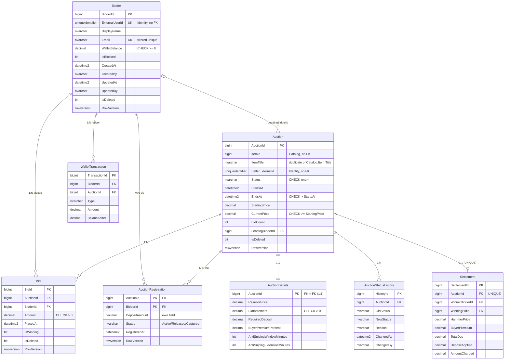

# ERD — Проєкт №1 (Auctions, SQL Server + ADO.NET/Dapper)

> Частина документації проєкту AuctionHouse. Повний опис і порядок запуску: [README.md](../README.md).

*Якщо діаграма не відображається, зображення вище — той самий ERD; текстове джерело (Mermaid) нижче.*

**Зв'язки (вимога «щонайменше 4 таблиці зі зв'язками 1:1, 1:N і M:N»).** Усього 8 таблиць.

| Тип | Де реалізовано | Як |
|---|---|---|
| **1:1** | `Auction` ↔ `AuctionDetails` | PK залежної таблиці `AuctionDetails.AuctionId` є одночасно FK на `Auction` |
| **1:1** | `Auction` ↔ `Settlement` | `UNIQUE (AuctionId)` у `Settlement` |
| **1:N** | `Auction` → `Bid`; `Bidder` → `Bid`; `Bidder` → `WalletTransaction`; `Auction` → `AuctionStatusHistory` | FK на боці «багатьох» |
| **M:N** | `Bidder` ↔ `Auction` через `AuctionRegistration` | проміжна таблиця з двома FK, складений PK `(AuctionId, BidderId)`, власні поля `DepositAmount`, `Status` |
