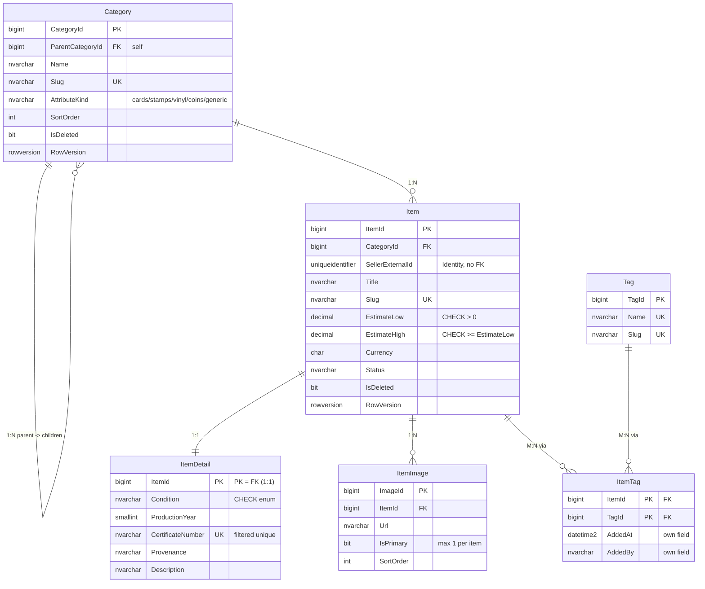

# ERD — Проєкт №2 (Catalog, SQL Server + EF Core)

> Частина документації проєкту AuctionHouse. Повний опис і порядок запуску: [README.md](../README.md).

*Якщо діаграма не відображається, зображення вище — той самий ERD; текстове джерело (Mermaid) нижче.*

**6 сутностей, усі типи зв'язків:**

| Тип | Де | Примітка |
|---|---|---|
| **1:1** | `Item` ↔ `ItemDetail` | PK залежної таблиці = FK; `ON DELETE CASCADE` |
| **1:N** | `Category` → `Item`; `Item` → `ItemImage`; `Category` → `Category` (ієрархія) | FK на боці «багатьох» |
| **M:N з власним полем** | `Item` ↔ `Tag` через `ItemTag` | проміжна сутність має власні поля **`AddedAt`** (дата додавання) і **`AddedBy`** |
