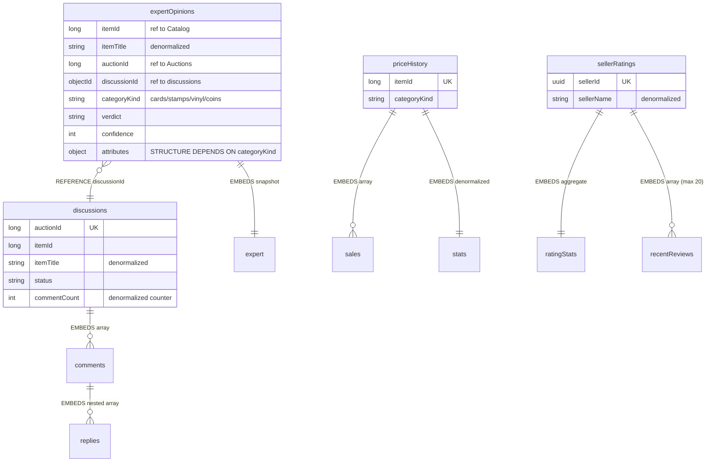

# Проєкт №3 (Community, MongoDB): колекції, приклади документів, запити

> Частина документації проєкту AuctionHouse. Повний опис і порядок запуску: [README.md](../README.md).

База `AuctionHouse_Community`, 4 колекції. `collections.js` створює колекції з **JSON Schema Validation** та індекси
(повторний запуск оновлює валідатор через `collMod`, тому це одночасно й «міграція схеми»), `seed.js` додає дані,
`queries.js` містить приклади запитів та aggregate pipeline.

### 6.1 Структура колекцій


*Якщо діаграма не відображається, зображення вище — той самий ERD; текстове джерело (Mermaid) нижче.*



| Колекція | Що моделює | Підхід |
|---|---|---|
| `expertOpinions` | висновок експерта про автентичність предмета | **гібрид**: посилання `itemId`/`auctionId`/`discussionId` + вбудований знімок експерта (`expert`) і денормалізована назва `itemTitle`; **гнучка схема** (див. нижче) |
| `discussions` | одне обговорення на аукціон | **embedding**: масив `comments[]`, у ньому вкладений масив `replies[]` (масив у масиві), лічильник `commentCount` |
| `priceHistory` | історія продажів предмета | **embedding** масиву `sales[]` + денормалізований об'єкт `stats` (`saleCount`, `avgPrice`, `minPrice`, `maxPrice`, `lastPrice`) для швидкого читання |
| `sellerRatings` | репутація продавця | **гібрид**: агрегований `stats` + вбудовані останні відгуки `recentReviews[]` (до 20); повна історія — окрема колекція в наступних лабораторних |

**Embedding чи referencing — обґрунтування.** Вбудовуємо те, що читається разом із коренем і не має сенсу окремо
(коментарі в обговоренні, продажі в історії цін). Посилаємось на слабкозв'язане або велике (висновок ↔ обговорення,
усе, що належить іншим контекстам).

**Гнучкість схеми: різні набори полів в одній колекції.** У `expertOpinions` об'єкт `attributes` залежить від `categoryKind`:

| `categoryKind` | Обов'язкові поля `attributes` | Приклад додаткових полів |
|---|---|---|
| `cards` | `gradingCompany`, `grade` | `certificateNumber`, `printRun`, `holoPattern` |
| `stamps` | `perforation`, `watermark` | `plateNumber`, `margins` (вкладений об'єкт), `cancellation` |
| `vinyl` | `matrixNumber`, `pressing` | `label`, `extras[]` (масив), `vinylCondition` |
| `coins` | `metal`, `weightGrams` | `mintMark`, `diameterMm` |

Відповідність `categoryKind` ↔ набір полів перевіряє `oneOf` у валідаторі: документ «cards» зі стемповими атрибутами СУБД відхиляє.

**Приклад документа** (`expertOpinions`, фрагмент):

```json
{
  "itemId": 1,
  "itemTitle": "Charizard Holo 1st Edition, Base Set 1999 (PSA 9)",
  "auctionId": 1,
  "discussionId": "ObjectId(65a000000000000000000101)",
  "categoryKind": "cards",
  "expert": { "userId": "UUID(5555…)", "displayName": "Dr. Andriy Savchuk", "credentials": ["Certified appraiser"] },
  "verdict": "authentic",
  "confidence": 96,
  "attributes": { "gradingCompany": "PSA", "grade": 9, "certificateNumber": "PSA-60000001" }
}
```

**Індекси** (під конкретні запити):

| Колекція | Індекс | Запит |
|---|---|---|
| `expertOpinions` | `{itemId:1, createdAt:-1}` | висновки по предмету, найновіші першими |
| `expertOpinions` | `{itemId:1, 'expert.userId':1}` **unique** | один експерт — один висновок на предмет |
| `expertOpinions` | `{categoryKind:1, verdict:1}` | модерація «сумнівні» за категорією |
| `expertOpinions` | `{discussionId:1}` sparse | висновки, пов'язані з обговоренням |
| `discussions` | `{auctionId:1}` **unique** | одне обговорення на аукціон |
| `discussions` | `{itemId:1}`; `{'comments.author.userId':1}` (multikey) | обговорення предмета; коментарі користувача |
| `priceHistory` | `{itemId:1}` **unique**; `{categoryKind:1,'stats.avgPrice':-1}` | історія предмета; аналітика категорій |
| `sellerRatings` | `{sellerId:1}` **unique**; `{'stats.average':-1,'stats.count':-1}` | рейтинг продавця; топ продавців |

**Запити й агрегації** (`queries.js`): пошук за полями, що є лише в частини документів; `$unwind` + `$group` по вкладеному масиву;
`$lookup` між колекціями за посиланням; групування за категорією; перевірка, що невалідний документ відхиляється валідатором.

---

### Додаткові приклади документів

**`discussions`** (вкладені масиви `comments[]` → `replies[]`):

```json
{
  "auctionId": 1,
  "itemId": 1,
  "itemTitle": "Charizard Holo 1st Edition, Base Set 1999 (PSA 9)",
  "status": "open",
  "commentCount": 4,
  "comments": [
    {
      "commentId": "ObjectId(...)",
      "author": { "userId": "UUID(3333...)", "displayName": "Marko Bondar" },
      "text": "Is the PSA slab free of scratches?",
      "createdAt": "2026-10-10T09:15:00Z",
      "replies": [
        { "commentId": "ObjectId(...)", "author": { "userId": "UUID(1111...)", "displayName": "Vintage Vault" },
          "text": "Yes, the case is clean.", "createdAt": "2026-10-10T10:02:00Z" }
      ]
    }
  ]
}
```

**`priceHistory`** (вбудований масив `sales[]` + денормалізований `stats`):

```json
{
  "itemId": 1,
  "categoryKind": "cards",
  "sales": [ { "auctionId": 9101, "finalPrice": "9400.00", "currency": "USD", "soldAt": "2024-03-14T19:00:00Z" } ],
  "stats": { "saleCount": 1, "avgPrice": "9400.00", "lastPrice": "9400.00" }
}
```

**`expertOpinions`** для марок — той самий набір колекції, інші поля `attributes`:

```json
{ "categoryKind": "stamps", "verdict": "authentic", "confidence": 91,
  "attributes": { "perforation": "Imperforate", "watermark": "Small Crown",
                  "margins": { "top": "clear", "bottom": "clear", "left": "clear", "right": "close" } } }
```

Повні дані — `db/p3/seed.js`, запити й агрегації — `db/p3/queries.js`.
